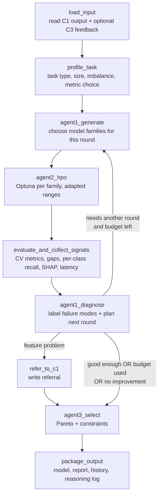
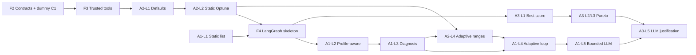

# C2 – Agentic AutoML Model Generation & Selection Engine
## Step-by-Step Implementation Guide

> Project: AI-Driven Integrated MLOps Platform (J26-SE-324)
> Component: **C2 – Agentic AutoML Model Generation and Selection Engine**
> Scope (first version): **labelled, tabular data (CSV / Excel), supervised learning**
> Task order: **binary classification → multiclass classification → regression**

---

## Table of Contents

- [Roadmap at a Glance](#roadmap-at-a-glance)
1. [What C2 Does (One-Page Summary)](#1-what-c2-does-one-page-summary)
2. [The Novelty of C2](#2-the-novelty-of-c2)
3. [Recommended Tools & Tech Stack](#3-recommended-tools--tech-stack)
4. [Should You Use Jupyter?](#4-should-you-use-jupyter)
5. [Folder Structure](#5-folder-structure)
6. [Working Without C1: The Dummy C1 Output](#6-working-without-c1-the-dummy-c1-output)
7. [Data Contracts (Inputs & Outputs)](#7-data-contracts-inputs--outputs)
8. [Overall Architecture (LangGraph Workflow)](#8-overall-architecture-langgraph-workflow)
9. [The Golden Rule: "Bounded LLM Orchestrator"](#9-the-golden-rule-bounded-llm-orchestrator)
10. [Agent 1 – Adaptive Model Generation (+ Diagnosis)](#10-agent-1--adaptive-model-generation--diagnosis)
11. [Agent 2 – Hyperparameter Optimization](#11-agent-2--hyperparameter-optimization)
12. [Agent 3 – Multi-Objective Selection](#12-agent-3--multi-objective-selection)
13. [Agent-Wise Roadmap (Simple → Advanced)](#13-agent-wise-roadmap-simple--advanced)
14. [Evaluation Plan (Proving the Novelty)](#14-evaluation-plan-proving-the-novelty)
15. [Preparing for Integration with C1, C3, C4](#15-preparing-for-integration-with-c1-c3-c4)
16. [Common Pitfalls & Tips](#16-common-pitfalls--tips)
17. [Checklist](#17-checklist)

---

## Roadmap at a Glance

A simple step-by-step list. Do the steps in order. Finish and test each step before starting the next. Details for each step are in §13.

**Step 0 – Get ready**
- Create the project folder, Python environment and Git setup.
- Install the libraries (§3).
- Learn the basics of Optuna and LangGraph.

**Step 1 – Fake C1 data + first models** *(binary classification only)*
- Download Adult Income + one imbalanced dataset.
- Make a "dummy C1 output" (train/test files + feature info + fake feature scores).
- Train Random Forest, XGBoost, LightGBM, CatBoost with default settings.
- Save the best model and a results table.
- ✅ This is **Baseline B0**.

**Step 2 – Normal tuning (Agent 2, simple)**
- Tune each model with Optuna, using **fixed** search ranges.
- Save every trial.
- ✅ This is **Baseline B2** – the main thing you will beat later.

**Step 3 – Build the agent workflow (LangGraph)**
- Connect the steps: load data → Agent 1 → Agent 2 → evaluate → Agent 3 → save output.
- Agent 1 picks models based on the dataset (small data, many categories, etc.).
- Agent 3 simply picks the model with the best score.
- ✅ One command runs the whole C2 pipeline (one round).

**Step 4 – Diagnosis + adaptive search ⭐ (your main novelty)**
- Agent 1 checks the results and names the problem: overfitting, underfitting, imbalance, weak features, or wrong model type.
- Agent 2 changes the search ranges based on that problem.
- Agent 1 keeps good models and drops weak ones.
- Repeat for several rounds until the score stops improving or the budget runs out.
- If the features are weak, write a message for C1.
- Log every decision with its numbers.
- ✅ You can show: "problem found → search changed → result improved".

**Step 5 – Add the LLM (carefully)**
- The LLM reads the numbers and suggests the next actions.
- It can only choose from a fixed list of allowed actions.
- Every LLM answer is checked. If it is wrong, use the rule-based decision.
- Keep an on/off switch so you can compare "with LLM" and "without LLM".

**Step 6 – Smart final choice (Agent 3, advanced)**
- Measure each model's speed and size, not only its accuracy.
- Remove models that break the limits (e.g. too slow).
- Find the best trade-offs (Pareto front) and pick a fast model that is almost as accurate as the best.
- Test the chosen model once on the hold-out test data.

**Step 7 – More problem types**
- Add multiclass classification.
- Add regression.
- Add Excel file input.

**Step 8 – Make it a service**
- Track all runs in MLflow.
- Add a FastAPI API so other components can call C2.

**Step 9 – Connect to other components (using mock data)**
- Accept C3 feedback (e.g. "don't use CatBoost", "must be faster").
- Send feature problems to C1.
- Accept retrain requests from C4.

**Step 10 – Prove it works (evaluation)**
- Create datasets with known problems and check that the diagnosis finds them.
- Compare your method with Baselines B0 and B2 using the same number of trials.
- Make the tables and charts for your thesis.

> 🎯 **Steps 1–4 are the most important.** They are enough to show your novelty. Do them well before moving on.

---

## 1. What C2 Does (One-Page Summary)

```
 C1 (features)  ──►  C2 (train, tune, reason, select)  ──►  C3 (validate)
                        ▲          │                          │
                        │          └── feature issues ──► C1  │
                        └──────────── rejection feedback ◄────┘
                        ▲
                        └──────────── retrain request ◄── C4
```

| Input to C2 | Output from C2 |
|---|---|
| Cleaned, selected features (train/test) | Selected model artifact (`.joblib` / native) |
| Preprocessing pipeline from C1 | Tuned hyperparameters |
| Feature Quality Scores (FQS) | Performance evidence (CV + hold-out metrics) |
| C1 decision log | Full search history (every round, every trial) |
| *(later)* C3 rejection feedback, C4 retrain requests | Auditable reasoning log (why each decision was made) |
| | Referrals to C1 (e.g. "features too weak") |

**Three agents:**

| Agent | Job | Main tool |
|---|---|---|
| **Agent 1 – Adaptive Model Generation** | Pick model families; diagnose *why* the last round worked/failed; change the next round | Rules + LLM over structured evidence |
| **Agent 2 – Hyperparameter Optimization** | Tune each candidate with Optuna (TPE); **adapt search ranges** based on the diagnosis | Optuna |
| **Agent 3 – Multi-Objective Selection** | Choose the final model balancing accuracy, latency, complexity (Pareto front) | Your own Pareto code / Optuna multi-objective |

---

## 2. The Novelty of C2

This is the most important section for your viva and thesis. Be precise and honest.

### 2.1 What already exists (so it is *not* your novelty)

| Existing work | What it does |
|---|---|
| Auto-sklearn, TPOT, H2O AutoML, AutoGluon, FLAML | Automatic model selection + HPO, but with **fixed, pre-defined search spaces** and no explicit reasoning about *why* a model failed |
| Optuna / Hyperopt | Efficient HPO (TPE, pruning), but the **search space is fixed by the user** |
| LLM data-science agents (e.g. AutoML-Agent, DS-Agent, AutoKaggle, CAAFE, MLAgentBench-style agents) | LLMs write code or suggest pipelines, often **free-form and hard to audit/reproduce** |

> Do a proper literature review on these (Google Scholar / arXiv) and put a comparison table in your thesis.

### 2.2 Your core novelty (one sentence)

> **"Diagnosis-conditioned AutoML": C2 explicitly diagnoses the failure mode of each search round (underfitting, overfitting, class imbalance, weak features, unsuitable model family) from structured training evidence, and uses that diagnosis to change BOTH the candidate model families AND the hyperparameter search ranges of the next round – with an LLM acting only as a bounded, auditable orchestrator over trusted training tools.**

### 2.3 Break it into defensible sub-contributions

| # | Contribution | Why it is new / useful | How you will prove it |
|---|---|---|---|
| N1 | **Diagnosis taxonomy + evidence signals** for tabular AutoML (train–val gap, CV variance, per-class recall, learning-curve slope, feature-importance concentration, FQS from C1) | Turns "the model is bad" into a *named, measurable* cause | Diagnosis accuracy on datasets with **injected, known faults** |
| N2 | **Diagnosis-conditioned search-space adaptation** (ranges shrink/shift/widen per diagnosis) | Standard HPO keeps ranges fixed | Same trial budget: adaptive vs. static ranges → better score / fewer trials |
| N3 | **Diagnosis-conditioned model-family selection** (drop/add families per round) | Standard AutoML tries all families blindly | Compute time saved, same or better final score |
| N4 | **Bounded LLM orchestration** – LLM chooses only from a validated action space, with deterministic fallback | Avoids hallucination; makes LLM decisions reproducible and auditable | Constraint-compliance rate = 100%; LLM vs. rule-only ablation |
| N5 | **Closed-loop feedback hooks** – feature issues routed to C1, C3 rejections respected in the next search | Connects AutoML into an MLOps lifecycle | Simulated C3 rejection → C2 changes behaviour correctly |
| N6 | **Operational multi-objective selection** (accuracy × latency × complexity, Pareto + constraints) | Most AutoML optimizes accuracy only | Hypervolume, constraint compliance, latency of chosen model |

**Your thesis claim is then:** *"Compared to a static AutoML baseline with the same compute budget, diagnosis-conditioned search reaches equal or better performance with fewer trials, produces explainable decisions, and selects models that satisfy operational constraints."*

---

## 3. Recommended Tools & Tech Stack

| Purpose | Tool | Why | Phase |
|---|---|---|---|
| Language | **Python 3.11** | Best support for all ML libs | 0 |
| Env / packages | **`venv` + `pip`** (`requirements.txt` + `pyproject.toml`) | Built into Python, simple, reproducible | 0 |
| Data | **pandas**, **numpy**, **openpyxl** (Excel), **pyarrow** (Parquet) | CSV/Excel reading, fast storage | 1 |
| Classic ML | **scikit-learn** | CV, metrics, baselines (LogReg, RF) | 1 |
| Boosting models | **XGBoost**, **LightGBM**, **CatBoost** | Required candidate families | 1 |
| HPO | **Optuna** (TPESampler, MedianPruner) | Required by spec; supports define-by-run ranges (needed for adaptation) | 2 |
| Agent workflow | **LangGraph** | ✅ Your choice is correct: graph + state + loops + conditional edges = perfect for "diagnose → re-search" cycles | 3 |
| LLM interface | **langchain-core** chat model + **structured output (Pydantic)** | Swap LLM providers without changing code | 5 |
| LLM provider | Claude API (e.g. `claude-sonnet-5-5`, or cheaper `claude-haiku-5-5`), OpenAI, **or** local **Ollama** (free, e.g. Llama/Qwen) | Use a cheap/local model in development, a stronger one for final experiments | 5 |
| Schemas / validation | **Pydantic v2** | Data contracts between components + validating LLM output | 1 |
| Experiment tracking | **MLflow** (local) | Logs every run, param, metric, artifact; C4 also uses MLflow → easy integration | 4 |
| Explainability (light) | **SHAP** (TreeExplainer) | Feature-importance concentration signal for diagnosis | 4 |
| API | **FastAPI** + **uvicorn** | Required for integration with other components | 8 |
| Config | **YAML** (+ pydantic-settings) | Budgets, constraints, model registry outside code | 1 |
| Testing | **pytest** | Each agent testable on its own | 1+ |
| Notebooks | **JupyterLab** (or VS Code notebooks) | Exploration & evaluation plots only | 0+ |
| Plots | **matplotlib** / **plotly** | Pareto fronts, optimization history | 6 |
| *(optional)* UI demo | **Streamlit** | Quick demo for presentations before the team UI exists | 8 |
| *(optional)* Container | **Docker** | Same as C3/C4; for final integration | 9 |

### Install (venv + pip)

Full step-by-step instructions are in **[C2_SETUP_GUIDE_AGENT1.md](C2_SETUP_GUIDE_AGENT1.md)**. Short version:

```bash
brew install python@3.11 libomp          # libomp is REQUIRED for XGBoost/LightGBM on Mac
cd components/C2-Agentic-AutoML
python3.11 -m venv .venv
source .venv/bin/activate
pip install -r requirements.txt -r requirements-dev.txt
pip install -e .
# later (Phase 3/5): pip install langgraph langchain-core + ONE provider package
#                    (langchain-anthropic / langchain-openai / langchain-ollama)
# later (Phase 4):   pip install mlflow shap
# later (Phase 8):   pip install fastapi uvicorn
```

---

## 4. Should You Use Jupyter?

**Yes – but only for the right things.**

| Use Jupyter for ✅ | Do NOT use Jupyter for ❌ |
|---|---|
| Exploring the dummy datasets | Agent logic |
| Trying a model/Optuna idea quickly | LangGraph workflow |
| Plotting Pareto fronts, optimization history | Data contracts / schemas |
| Running and visualizing **evaluation experiments** (thesis figures) | Anything that FastAPI or other components will call |
| Demo walkthrough for supervisors | |

**Rule:** All real code lives in `src/c2_automl/` as a Python package. Notebooks only `import` from it:

```python
# notebooks/03_run_pipeline_demo.ipynb
from c2_automl.graph import build_graph
from c2_automl.io.dummy_c1 import load_c1_output

state = build_graph().invoke({"c1": load_c1_output("data/c1_output/adult")})
```

This keeps your component testable, integrable, and your notebooks clean.

---

## 5. Folder Structure

```
components/C2-Agentic-AutoML/
├── README.md
├── C2_IMPLEMENTATION_GUIDE.md        ← this file
├── pyproject.toml
├── configs/
│   ├── default.yaml                  # budgets, CV folds, metric per task, constraints
│   ├── model_registry.yaml           # model families + base search spaces
│   └── diagnosis_rules.yaml          # thresholds (e.g. overfit gap > 0.05)
├── data/
│   ├── raw/                          # downloaded Kaggle/OpenML files (git-ignored)
│   └── c1_output/<dataset_name>/     # DUMMY C1 output (see §6)
├── src/c2_automl/
│   ├── __init__.py
│   ├── schemas.py                    # Pydantic contracts (C1Output, C2Output, Diagnosis, ...)
│   ├── config.py
│   ├── io/
│   │   ├── dummy_c1.py               # builds/loads dummy C1 output
│   │   └── artifacts.py              # save model, reports
│   ├── tools/                        # TRUSTED computation (no LLM here)
│   │   ├── models.py                 # model factory (RF, XGB, LGBM, CatBoost)
│   │   ├── train_eval.py             # CV training + metrics
│   │   ├── signals.py                # diagnosis evidence signals
│   │   ├── search_space.py           # base + adaptive ranges
│   │   ├── hpo.py                    # Optuna runner
│   │   ├── profiling.py              # latency, model size, complexity
│   │   └── pareto.py                 # Pareto front + selection
│   ├── agents/
│   │   ├── agent1_generation.py      # diagnosis + candidate selection
│   │   ├── agent2_hpo.py             # adaptive HPO
│   │   ├── agent3_selection.py       # multi-objective selection
│   │   ├── llm.py                    # LLM client + structured output + fallback
│   │   └── guardrails.py             # validate LLM decisions
│   ├── graph.py                      # LangGraph workflow
│   ├── state.py                      # graph state definition
│   └── api.py                        # FastAPI (Phase 8)
├── notebooks/
│   ├── 01_explore_datasets.ipynb
│   ├── 02_baseline_models.ipynb
│   ├── 03_run_pipeline_demo.ipynb
│   └── 04_evaluation_results.ipynb
├── experiments/                      # scripts that produce thesis results
│   ├── run_baseline_static.py
│   ├── run_agentic.py
│   └── inject_faults.py
├── outputs/                          # model artifacts, reports, logs (git-ignored)
└── tests/
    ├── test_schemas.py
    ├── test_signals.py
    ├── test_search_space.py
    └── test_pareto.py
```

---

## 6. Working Without C1: The Dummy C1 Output

C1 is not ready, so you **simulate its output**. The key idea: **agree the format (contract) now**, so when C1 is ready you only replace the loader.

### 6.1 Recommended datasets

Pick datasets that are clean enough (C1's job is cleaning) but have *different characteristics* – this is needed later to show that your diagnosis works.

| Task | Dataset | Source | Why useful |
|---|---|---|---|
| Binary (start here) | **Adult Income** | UCI / OpenML / Kaggle | Mixed types, mild imbalance (~24%) |
| Binary | **Telco Customer Churn** | Kaggle | Classic business case, imbalance |
| Binary | **Give Me Some Credit** / **Credit Card Fraud** | Kaggle | **Strong imbalance** → tests imbalance diagnosis |
| Binary | **Pima Indians Diabetes** | Kaggle / UCI | **Small dataset** → overfitting easily appears |
| Multiclass | **Wine Quality**, **Dry Bean**, **Covertype** (sample) | UCI / OpenML | Different class counts and imbalance |
| Regression | **California Housing**, **House Prices (Ames)**, **Bike Sharing** | sklearn / Kaggle | Standard regression benchmarks |

> **Tip:** Use OpenML via `sklearn.datasets.fetch_openml(...)` where possible – fully reproducible, no manual download. Matches the loan-default example in the proposal: "Give Me Some Credit" or a Kaggle loan-default dataset is a good "story" dataset.

### 6.2 What the dummy C1 output folder contains

```
data/c1_output/adult/
├── X_train.parquet
├── y_train.parquet
├── X_test.parquet           # hold-out; C2 must NOT tune on this
├── y_test.parquet
├── preprocessing.joblib     # simple sklearn pipeline (impute + encode)
├── feature_metadata.json    # feature types, which are categorical
├── fqs.json                 # fake Feature Quality Scores per feature (0–1)
└── manifest.json            # task_type, target, positive_class, class balance, C1 decision log
```

### 6.3 Generating it (`src/c2_automl/io/dummy_c1.py` – sketch)

```python
from sklearn.feature_selection import mutual_info_classif, mutual_info_regression
from sklearn.model_selection import train_test_split

def build_dummy_c1(df, target, task_type, out_dir, test_size=0.2, seed=42):
    """Simulates C1: basic cleaning + split + fake FQS (from mutual information)."""
    df = df.dropna(subset=[target])
    X, y = df.drop(columns=[target]), df[target]
    # simple imputation / encoding (C1 will do this properly later)
    # ...
    stratify = y if task_type != "regression" else None
    X_tr, X_te, y_tr, y_te = train_test_split(X, y, test_size=test_size,
                                              stratify=stratify, random_state=seed)
    mi_fn = mutual_info_regression if task_type == "regression" else mutual_info_classif
    mi = mi_fn(X_tr, y_tr, random_state=seed)
    fqs = {c: float(v / (mi.max() + 1e-9)) for c, v in zip(X_tr.columns, mi)}
    # write parquet files, fqs.json, feature_metadata.json, manifest.json ...
```

Using mutual information for the fake FQS is a reasonable stand-in, and it gives your "weak features" diagnosis a real signal to work with.

---

## 7. Data Contracts (Inputs & Outputs)

Define them in `schemas.py` with Pydantic **in week 1** and share them with your C1 and C3 teammates.

```python
from enum import Enum
from pydantic import BaseModel, Field

class TaskType(str, Enum):
    BINARY = "binary"
    MULTICLASS = "multiclass"
    REGRESSION = "regression"

class C1Output(BaseModel):
    dataset_id: str
    task_type: TaskType
    target: str
    data_dir: str                       # where parquet files are
    feature_types: dict[str, str]       # "numeric" | "categorical"
    fqs: dict[str, float]               # feature -> quality score 0..1
    class_distribution: dict[str, float] | None = None
    decision_log: list[str] = []

class DiagnosisLabel(str, Enum):
    UNDERFITTING = "underfitting"
    OVERFITTING = "overfitting"
    IMBALANCE = "class_imbalance"
    WEAK_FEATURES = "weak_features"
    UNSUITABLE_FAMILY = "unsuitable_model_family"
    HEALTHY = "healthy"

class Diagnosis(BaseModel):
    model_family: str
    labels: list[DiagnosisLabel]
    evidence: dict[str, float]          # the numbers that support the labels
    confidence: float = Field(ge=0, le=1)

class C3Feedback(BaseModel):            # mocked until C3 exists
    decision: str                       # PROMOTE | HOLD | ROLLBACK
    reasons: list[str]                  # e.g. ["poor_calibration", "subgroup_failure:age<25"]
    blocked_families: list[str] = []
    constraints: dict[str, float] = {}  # e.g. {"max_latency_ms": 5}

class C2Output(BaseModel):
    dataset_id: str
    run_id: str
    selected_model_path: str
    model_family: str
    hyperparameters: dict
    metrics_cv: dict[str, float]
    metrics_holdout: dict[str, float]
    latency_ms_per_1k: float
    model_size_kb: float
    pareto_front: list[dict]
    search_history_path: str            # all rounds + all Optuna trials
    reasoning_log: list[dict]           # every diagnosis/decision with evidence
    referrals_to_c1: list[str] = []
```

---

## 8. Overall Architecture (LangGraph Workflow)

### 8.1 Graph



### 8.2 State (`state.py`)

```python
from typing import TypedDict, Annotated
import operator

class C2State(TypedDict, total=False):
    c1: dict                                  # C1Output as dict
    c3_feedback: dict | None
    task_profile: dict                        # n_rows, n_features, imbalance_ratio, metric
    round: int
    max_rounds: int
    candidate_families: list[str]             # chosen by Agent 1
    search_spaces: dict[str, dict]            # family -> adapted ranges
    trial_results: Annotated[list[dict], operator.add]   # accumulate across rounds
    signals: dict[str, dict]                  # family -> evidence signals
    diagnoses: dict[str, dict]                # family -> Diagnosis
    reasoning_log: Annotated[list[dict], operator.add]
    referrals_to_c1: Annotated[list[str], operator.add]
    best_score_history: list[float]
    stop_reason: str | None
    selection: dict | None                    # Agent 3 output
```

### 8.3 Graph builder (`graph.py`)

```python
from langgraph.graph import StateGraph, START, END
from .state import C2State
from .agents import agent1_generation as a1, agent2_hpo as a2, agent3_selection as a3
from . import nodes

def route_after_diagnosis(state: C2State) -> str:
    if state.get("stop_reason"):
        return "refer_to_c1" if state.get("referrals_to_c1") else "agent3_select"
    return "agent1_generate"

def build_graph():
    g = StateGraph(C2State)
    g.add_node("load_input", nodes.load_input)
    g.add_node("profile_task", nodes.profile_task)
    g.add_node("agent1_generate", a1.generate_candidates)
    g.add_node("agent2_hpo", a2.run_hpo)
    g.add_node("evaluate", nodes.evaluate_and_collect_signals)
    g.add_node("agent1_diagnose", a1.diagnose_and_plan)
    g.add_node("refer_to_c1", nodes.refer_to_c1)
    g.add_node("agent3_select", a3.select_model)
    g.add_node("package_output", nodes.package_output)

    g.add_edge(START, "load_input")
    g.add_edge("load_input", "profile_task")
    g.add_edge("profile_task", "agent1_generate")
    g.add_edge("agent1_generate", "agent2_hpo")
    g.add_edge("agent2_hpo", "evaluate")
    g.add_edge("evaluate", "agent1_diagnose")
    g.add_conditional_edges("agent1_diagnose", route_after_diagnosis,
                            ["agent1_generate", "refer_to_c1", "agent3_select"])
    g.add_edge("refer_to_c1", "agent3_select")
    g.add_edge("agent3_select", "package_output")
    g.add_edge("package_output", END)
    return g.compile()
```

> Later you can add a LangGraph **checkpointer** (e.g. SQLite) so long runs can resume, and so the full state history is stored for auditing.

---

## 9. The Golden Rule: "Bounded LLM Orchestrator"

The spec says: *"LLM agents act as bounded orchestrators over structured evidence; trusted training tools execute the actual computations."* This means:

| The LLM **does** | The LLM **does NOT** |
|---|---|
| Read structured evidence (JSON of metrics, signals) | Train models or compute metrics |
| Pick a diagnosis label from a **fixed enum** | Write and execute arbitrary code |
| Pick actions from a **fixed action list** | Invent new hyperparameters or model families |
| Write a short natural-language justification | Touch the test set |

### Three layers for every decision

```
1. Deterministic signals (tools/signals.py)  ──►  numbers, always computed
2. Rule-based proposal (diagnosis_rules.yaml) ──►  baseline decision, always available
3. LLM refinement (optional)                  ──►  structured JSON, validated by guardrails
                                                   └─ invalid? → fall back to rule decision
```

Benefits: works with **no LLM** (good for development and as an ablation baseline), is reproducible, and every decision is auditable.

### LLM call with structured output + guardrail (sketch, `agents/llm.py`)

```python
from pydantic import BaseModel
from langchain_core.language_models import BaseChatModel

ALLOWED_ACTIONS = {
    "shrink_depth_range", "increase_regularization", "widen_depth_range",
    "increase_n_estimators", "lower_learning_rate", "enable_class_weights",
    "drop_family", "add_family", "refer_features_to_c1", "stop_search",
}

class PlanDecision(BaseModel):
    diagnosis: list[str]          # must be DiagnosisLabel values
    actions: list[str]            # must be in ALLOWED_ACTIONS
    families_next_round: list[str]
    rationale: str

def llm_plan(llm: BaseChatModel, evidence: dict, rule_plan: PlanDecision) -> PlanDecision:
    try:
        structured = llm.with_structured_output(PlanDecision)
        plan = structured.invoke(build_prompt(evidence, rule_plan))
        return validate_or_fallback(plan, rule_plan)   # guardrails.py
    except Exception:
        return rule_plan                                # never block the pipeline
```

Set `temperature=0`, log the exact prompt + response in `reasoning_log`, and cache responses (by evidence hash) so experiments are repeatable.

---

## 10. Agent 1 – Adaptive Model Generation (+ Diagnosis)

### 10.1 Responsibilities

1. **Round 1:** choose starting model families from the task profile.
2. **After each round:** read evidence signals → **diagnose** each family → decide the next round:
   - which families to keep / drop / add,
   - which **search-space adjustments** to send to Agent 2,
   - whether to **refer feature issues to C1**,
   - whether to **stop**.
3. **Respect C3 feedback:** never retry blocked families; apply C3 constraints.

### 10.2 Model registry (`configs/model_registry.yaml`)

```yaml
families:
  logistic_regression: {tasks: [binary, multiclass], role: simple_baseline}
  ridge:               {tasks: [regression],          role: simple_baseline}
  random_forest:       {tasks: [binary, multiclass, regression]}
  xgboost:             {tasks: [binary, multiclass, regression]}
  lightgbm:            {tasks: [binary, multiclass, regression]}
  catboost:            {tasks: [binary, multiclass, regression], good_for: many_categoricals}
```

> Adding a simple linear baseline is useful: if a linear model is as good as boosting, that is evidence for "data is simple / features weak", and gives Agent 3 a cheap, fast option.

### 10.3 Initial selection rules (round 1)

| Condition | Start with |
|---|---|
| Default | RandomForest, XGBoost, LightGBM |
| Many categorical features (> 30%) | + CatBoost |
| Very small data (< 1,000 rows) | RandomForest, CatBoost, LogisticRegression (boosting overfits easily) |
| Large data (> 200k rows) | LightGBM first (fastest) |
| C3 blocked a family | Remove it |

### 10.4 Evidence signals (`tools/signals.py`) – computed by trusted code

| Signal | How to compute |
|---|---|
| `train_score`, `val_score` | Mean over CV folds |
| `generalization_gap` | `train_score − val_score` |
| `cv_std` | Std of validation scores across folds (instability) |
| `baseline_score` | Score of a dummy model (majority class / mean) |
| `lift_over_baseline` | `val_score − baseline_score` |
| `per_class_recall` / `minority_recall` | From out-of-fold predictions |
| `imbalance_ratio` | minority / majority class size |
| `learning_curve_slope` | Score at 50% vs 100% of training data (still improving → more data/capacity helps) |
| `best_trial_at_range_edge` | Did the best Optuna params hit the min/max of a range? (→ widen range) |
| `importance_concentration` | Share of SHAP importance in top-k features |
| `mean_fqs`, `low_fqs_fraction` | From C1 |
| `family_rank` | Relative rank of this family among all families this round |

### 10.5 Diagnosis rules (`configs/diagnosis_rules.yaml`) → actions

Thresholds are **starting values**; tuning and justifying them is part of your research.

| Diagnosis | Evidence (example rule) | Action for next round |
|---|---|---|
| **Overfitting** | `gap > 0.05` AND `train_score > 0.95` | Shrink `max_depth` / `num_leaves` ranges downward, raise `min_child_samples`, raise L1/L2 reg ranges, lower `subsample`/`colsample` upper bound |
| **Underfitting** | `train_score` low AND `gap < 0.02` AND `learning_curve_slope ≈ 0` | Widen depth/leaves upward, increase `n_estimators`, lower regularization, try stronger family |
| **Class imbalance** | `imbalance_ratio < 0.2` AND `minority_recall < 0.5` | Enable `class_weight` / `scale_pos_weight` (add it to the search space), switch metric to F1/PR-AUC, refer to C1 for resampling |
| **Weak features** | All families have low `lift_over_baseline` AND `mean_fqs` low | Stop wasting trials; **refer to C1** (feature engineering needed) |
| **Unsuitable family** | Family is consistently far below the best family (e.g. > 3% worse for 2 rounds) | Drop family; reallocate its trial budget |
| **Range-edge hit** | Best param at range boundary | Extend that range in that direction |
| **Healthy / converged** | Improvement < ε for 2 rounds | Stop search |

### 10.6 Output of Agent 1 per round (stored in `reasoning_log`)

```json
{
  "round": 2,
  "agent": "agent1",
  "family": "xgboost",
  "diagnosis": ["overfitting"],
  "evidence": {"train_auc": 0.991, "val_auc": 0.902, "gap": 0.089, "cv_std": 0.012},
  "actions": ["shrink_depth_range", "increase_regularization"],
  "families_next_round": ["xgboost", "lightgbm", "catboost"],
  "decided_by": "rules+llm",
  "rationale": "Large train-validation gap with high train AUC indicates overfitting..."
}
```

---

## 11. Agent 2 – Hyperparameter Optimization

### 11.1 Responsibilities

1. Build the **search space** for each family = base space **+ adjustments from Agent 1**.
2. Run **Optuna (TPE)** with CV inside the objective (**train data only**).
3. Use **pruning** to stop bad trials early.
4. Return **full trial evidence** (params, fold scores, train score, time) – Agent 1 needs it for diagnosis.

### 11.2 Adaptive search space (`tools/search_space.py`)

Store ranges as data (not hard-coded in the objective) so they can be modified:

```python
BASE_SPACES = {
    "xgboost": {
        "max_depth":        {"type": "int",   "low": 3,    "high": 10},
        "learning_rate":    {"type": "float", "low": 0.01, "high": 0.3, "log": True},
        "n_estimators":     {"type": "int",   "low": 100,  "high": 800},
        "min_child_weight": {"type": "float", "low": 1,    "high": 10, "log": True},
        "subsample":        {"type": "float", "low": 0.6,  "high": 1.0},
        "colsample_bytree": {"type": "float", "low": 0.6,  "high": 1.0},
        "reg_lambda":       {"type": "float", "low": 1e-3, "high": 10, "log": True},
    },
    # lightgbm, catboost, random_forest ...
}

ACTION_EFFECTS = {   # action -> how to modify ranges (multiplicative, bounded)
    "shrink_depth_range":      {"max_depth": {"high": 0.6}},
    "widen_depth_range":       {"max_depth": {"high": 1.5}},
    "increase_regularization": {"reg_lambda": {"low": 10, "high": 5},
                                "min_child_weight": {"low": 2}},
    "increase_n_estimators":   {"n_estimators": {"high": 2.0}},
    "lower_learning_rate":     {"learning_rate": {"high": 0.5}},
}

def adapt_space(space: dict, actions: list[str], hard_limits: dict) -> dict:
    """Apply actions to ranges, clip to hard limits, keep low < high. Pure function → easy to unit test."""
    ...
```

Then in the Optuna objective:

```python
def suggest(trial, space):
    params = {}
    for name, r in space.items():
        if r["type"] == "int":
            params[name] = trial.suggest_int(name, r["low"], r["high"], log=r.get("log", False))
        elif r["type"] == "float":
            params[name] = trial.suggest_float(name, r["low"], r["high"], log=r.get("log", False))
        elif r["type"] == "cat":
            params[name] = trial.suggest_categorical(name, r["choices"])
    return params
```

### 11.3 Optuna setup

| Setting | Recommendation |
|---|---|
| Sampler | `TPESampler(seed=..., multivariate=True)` |
| Pruner | `MedianPruner(n_warmup_steps=1)` – report score after each CV fold |
| Study per | (dataset, round, family) – name it e.g. `adult_r2_xgboost` |
| Storage | `sqlite:///outputs/optuna.db` (lets you inspect with `optuna-dashboard`) |
| Warm start | `study.enqueue_trial(best_params_prev_round)` if still inside new ranges |
| Budget | Fixed **total** trial budget per run (e.g. 150), split across rounds/families by Agent 1 – essential for a fair comparison with the static baseline |
| Metric | Binary: ROC-AUC (or PR-AUC if imbalanced); Multiclass: macro-F1 / log-loss; Regression: RMSE (minimize) |
| CV | `StratifiedKFold(5)` for classification, `KFold(5)` for regression |

### 11.4 Trial evidence returned

For every trial: `family, round, params, fold_val_scores, mean_val, mean_train, fit_time, state (COMPLETE/PRUNED)`. Save as Parquet/CSV → this is your **search history** output.

---

## 12. Agent 3 – Multi-Objective Selection

### 12.1 Objectives

| Objective | Direction | How to measure |
|---|---|---|
| Predictive performance | maximize | Mean CV score of the best config per family (or top-N configs) |
| Prediction latency | minimize | Median time to predict 1,000 rows (repeat ~20 times, after warm-up) |
| Complexity | minimize | Serialized model size (KB) and/or total trees × leaves |
| *(optional)* Stability | minimize | `cv_std` |

### 12.2 Steps

1. Take the best K configs of each family (not only the single best → richer front).
2. Refit each on full training data; measure latency and size (`tools/profiling.py`).
3. Apply **hard constraints** (from config or C3), e.g. `latency_ms_per_1k ≤ 50`, `size_kb ≤ 20,000`.
4. Compute the **Pareto front** (non-dominated set).
5. Choose one model from the front:
   - **Simple v1:** best score among models within ε (e.g. 0.5%) of the top score → pick the fastest/smallest.
   - **Advanced:** knee-point selection, or weighted utility with user-given weights.
6. Evaluate the chosen model **once** on the hold-out test set → `metrics_holdout`.
7. LLM (optional) writes the human-readable justification of the trade-off, based only on the numbers.

### 12.3 Pareto code (`tools/pareto.py`)

```python
import numpy as np

def pareto_front(points: np.ndarray, maximize: list[bool]) -> np.ndarray:
    """points: (n, k). Returns boolean mask of non-dominated rows."""
    P = np.where(maximize, -points, points)        # convert all to minimization
    n = len(P)
    mask = np.ones(n, dtype=bool)
    for i in range(n):
        if not mask[i]:
            continue
        dominated = np.all(P <= P[i], axis=1) & np.any(P < P[i], axis=1)
        if dominated.any():
            mask[i] = False
    return mask
```

> For evaluation, compute **hypervolume** of the front (e.g. `pymoo` or `optuna` utilities) to compare fronts across methods.

---

## 13. Agent-Wise Roadmap (Simple → Advanced)

Each agent is built in **levels**. Level 1 is the simplest working version. Each higher level adds one feature on top of it. The agents depend on each other, so §13.5 shows the order in which to build the levels across all agents. That order matches the Phase 0–10 numbering used in the rest of this guide.

**Rule for every level:** it must run end-to-end, have at least one test, and be committed before you start the next level.

### 13.1 Foundation (shared, built before and around the agents)

The agents need these parts, but they are not agents themselves.

| Level | What to build | Files | Done when | Phase |
|---|---|---|---|---|
| F1 – Setup | `pyproject.toml`, folders, `.gitignore` (`data/raw`, `outputs`, `.env`), Jupyter | `pyproject.toml` | `pytest` runs; Jupyter opens | 0 |
| F2 – Contracts + dummy C1 | `C1Output`, `C2Output` schemas; dummy C1 output for **Adult Income** + one imbalanced binary dataset | `schemas.py`, `io/dummy_c1.py` | `load_c1_output("data/c1_output/adult")` returns a valid `C1Output` | 1 |
| F3 – Trusted tools | Model factory (RF, XGBoost, LightGBM, CatBoost), 5-fold CV training, metrics | `tools/models.py`, `tools/train_eval.py` | One function trains any family and returns fold scores | 1 |
| F4 – LangGraph skeleton | `C2State`, graph with nodes load → profile → agent1 → agent2 → evaluate → agent3 → package (single round, no loop) | `state.py`, `graph.py` | `build_graph().invoke(...)` writes a complete `C2Output` JSON | 3 |
| F5 – More task types | Multiclass + regression metrics, CV splitters, Excel input | `tools/train_eval.py`, `io/dummy_c1.py` | Graph runs on Wine Quality and California Housing | 7 |
| F6 – Service + tracking | MLflow logging (parent run per C2 run, nested per round/family); FastAPI endpoints (§15) | `api.py` | `POST /c2/runs` starts a run; results visible in MLflow UI | 4 (MLflow), 8 (API) |
| F7 – Evaluation | Fault injection, baseline scripts, experiment runner, result notebook | `experiments/`, `notebooks/04_*` | E1–E5 tables and figures produced (§14) | 10 |

---

### 13.2 Agent 1 – Adaptive Model Generation (+ Diagnosis)

```
L1 Static list → L2 Profile-aware start → L3 Rule diagnosis ⭐ → L4 Adaptive loop ⭐ → L5 Bounded LLM → L6 Feedback loops
```

#### A1-L1 – Static candidate list (Phase 1 / 3)
- **Goal:** Agent 1 exists as a graph node but makes no real decisions yet.
- **Tasks:**
  - Create `configs/model_registry.yaml` (§10.2).
  - `generate_candidates()` returns every family that supports the task type.
- **Files:** `agents/agent1_generation.py`, `configs/model_registry.yaml`
- **Done when:** for a binary task the node returns `[random_forest, xgboost, lightgbm, catboost]`.

#### A1-L2 – Profile-aware initial selection (Phase 3)
- **Goal:** the first round's model families depend on the dataset.
- **Tasks:**
  - `profile_task` node: n_rows, n_features, % categorical, imbalance ratio, metric choice.
  - Implement the round-1 rules from §10.3 (small data, many categoricals, large data).
  - Write each choice and its reason into `reasoning_log`.
- **Done when:** Pima (small) and Adult (larger) start with **different** family lists, and the log says why.

#### A1-L3 – Rule-based diagnosis ⭐ core novelty (Phase 4)
- **Goal:** turn round results into named failure modes, backed by numbers.
- **Tasks:**
  - `tools/signals.py`: gap, cv_std, lift over baseline, minority recall, imbalance ratio, range-edge hit, learning-curve slope, mean FQS (§10.4). Start with gap, cv_std and minority recall, then add the rest.
  - `configs/diagnosis_rules.yaml` + `Diagnosis` schema.
  - `diagnose_and_plan()` maps signals → diagnosis labels → actions (§10.5).
  - Unit tests with hand-made signal values for each diagnosis.
- **Done when:** on Pima with deep trees allowed, the log shows `overfitting` with the gap value as evidence; on the imbalanced dataset it shows `class_imbalance`.

#### A1-L4 – Adaptive multi-round loop ⭐ core novelty (Phase 4)
- **Goal:** the diagnosis actually changes the next round.
- **Tasks:**
  - Conditional edge `agent1_diagnose → agent1_generate` (§8.3).
  - Keep / drop / add families; drop "unsuitable family" after 2 weak rounds.
  - Split the **total** trial budget across rounds and families (give dropped families' trials to better ones).
  - Stop rules: budget used, `max_rounds`, improvement < ε for 2 rounds, or weak features.
  - `refer_to_c1` node writes a referral when features are weak.
  - Send the chosen actions to Agent 2 (needs **A2-L4**).
- **Done when:** a 3-round run on Pima shows overfitting → ranges shrunk → smaller gap, and the total trials never exceed the budget.

#### A1-L5 – Bounded LLM reasoning (Phase 5)
- **Goal:** the LLM improves or explains the rule decision but can never break the pipeline.
- **Tasks:**
  - `agents/llm.py`: provider-agnostic chat model, `with_structured_output(PlanDecision)`, temperature 0, cache keyed by an evidence hash.
  - `agents/guardrails.py`: check the diagnosis enum, action allow-list, family allow-list, budget and C3-blocked families; fall back to the rule plan if anything fails.
  - Config flag `use_llm: true/false`.
  - Log prompt, raw response, validation result and `decided_by` (`rules` / `rules+llm` / `fallback`).
- **Done when:** the same run works with `use_llm: false` and `true`, and a deliberately broken LLM reply (e.g. an unknown action) is rejected and logged.

#### A1-L6 – Feedback loops (Phase 7 / 9)
- **Goal:** Agent 1 reacts to the other components and to other task types.
- **Tasks:**
  - Regression diagnosis rules (no imbalance; use residual and error signals instead) – Phase 7.
  - Read `C3Feedback`: remove blocked families, pass constraints to Agent 3, map reasons to actions (e.g. `poor_calibration` → prefer calibrated models) – Phase 9.
  - C4 retrain request: start from the previous run's best families and diagnoses – Phase 9.
- **Done when:** a mock C3 `HOLD` with `blocked_families: [catboost]` leads to a new run that has no CatBoost and respects the new constraints.

---

### 13.3 Agent 2 – Hyperparameter Optimization

```
L1 Default params → L2 Static Optuna → L3 Pruning + budget → L4 Adaptive ranges ⭐ → L5 Warm start + imbalance params → L6 Tasks + retrain
```

#### A2-L1 – Default parameters (Phase 1)
- **Goal:** train each candidate with library defaults. This gives **baseline B0**.
- **Tasks:** `run_hpo()` just calls the trusted CV training with default params and returns one "trial" per family in the standard trial format.
- **Done when:** a comparison table of the 4 families is saved, and the best model is stored with a JSON report.

#### A2-L2 – Static Optuna TPE (Phase 2)
- **Goal:** real tuning with **fixed** ranges. This gives **baseline B2**, your most important comparison. Random search over the same ranges gives **B1**.
- **Tasks:**
  - `tools/search_space.py` with `BASE_SPACES` stored as data (§11.2) and the `suggest()` helper.
  - `tools/hpo.py`: objective = CV score on **train data only**; `TPESampler(seed, multivariate=True)`; a sampler option for random search.
  - Save every trial: family, round, params, fold scores, train score, fit time, state.
- **Done when:** tuned models beat defaults on Adult, and the trial history is saved as Parquet.

#### A2-L3 – Pruning, storage, budget (Phase 2 / 4)
- **Goal:** spend trials efficiently and make every study inspectable.
- **Tasks:**
  - `MedianPruner`: report the score after each CV fold.
  - SQLite storage `outputs/optuna.db`; study name `<dataset>_r<round>_<family>`.
  - Accept a per-family trial budget from Agent 1.
- **Done when:** pruned trials appear in the history, and `optuna-dashboard` shows the studies.

#### A2-L4 – Diagnosis-conditioned range adaptation ⭐ core novelty (Phase 4)
- **Goal:** search ranges change based on Agent 1's diagnosis instead of staying fixed.
- **Tasks:**
  - `ACTION_EFFECTS` table and `adapt_space(space, actions, hard_limits)` as a **pure function** (§11.2).
  - Hard limits so ranges never become invalid (`low < high`, values inside safe bounds).
  - Range-edge rule: if the best value hit a boundary, extend the range in that direction.
  - Save the range used in every round, so a "before → after" view goes in the reasoning log.
  - Unit tests: each action changes exactly the expected parameters.
- **Done when:** after an `overfitting` diagnosis, round 2's `max_depth` upper bound is smaller and the log shows the old and new ranges.

#### A2-L5 – Warm start + imbalance parameters (Phase 4)
- **Goal:** don't lose earlier progress, and handle imbalance inside tuning.
- **Tasks:**
  - `study.enqueue_trial(prev_best)` when the previous best is still inside the new ranges.
  - `enable_class_weights` action adds `class_weight` / `scale_pos_weight` / `auto_class_weights` to the space.
  - Switch the objective metric to PR-AUC or F1 when imbalance is diagnosed.
- **Done when:** on the imbalanced dataset, minority recall improves in the round after the diagnosis.

#### A2-L6 – Other task types + retraining (Phase 7 / 9)
- **Tasks:** multiclass objectives (`multi:softprob`, macro-F1 / log-loss) and regression objectives (RMSE, minimize) – Phase 7; warm start from the previous run's history on a C4 retrain request – Phase 9.
- **Done when:** the same HPO code runs on all three task types without special-case code in the agent.

---

### 13.4 Agent 3 – Multi-Objective Selection

```
L1 Best score → L2 Measure cost + constraints → L3 Pareto + ε-rule → L4 Knee / weights + hypervolume → L5 LLM justification → L6 C3 constraints
```

#### A3-L1 – Best CV score (Phase 3)
- **Goal:** a working final step so the pipeline produces a `C2Output`.
- **Tasks:** pick the highest mean CV score; refit on full training data; evaluate **once** on hold-out; save the model + report.
- **Done when:** `C2Output` has `selected_model_path`, `metrics_cv` and `metrics_holdout`.

#### A3-L2 – Measure cost + hard constraints (Phase 6)
- **Goal:** know what each candidate costs to run.
- **Tasks:**
  - `tools/profiling.py`: median latency per 1,000 rows (warm-up + ~20 repeats), serialized size in KB, trees × leaves.
  - Take the top-K configs per family, not only the single best.
  - Filter by hard constraints from config (e.g. `max_latency_ms`, `max_size_kb`).
- **Done when:** every candidate has score, latency and size, and constraint violations are logged.

#### A3-L3 – Pareto front + ε-rule selection (Phase 6)
- **Goal:** balance accuracy against latency and complexity.
- **Tasks:**
  - `tools/pareto.py` `pareto_front()` (§12.3) + unit tests with small hand-made point sets.
  - ε-rule: among Pareto models within ε (e.g. 0.5%) of the top score, choose the fastest / smallest.
  - Add `pareto_front` to `C2Output`.
- **Done when:** on at least one dataset the chosen model is **not** the top-accuracy one but is much faster, with less accuracy lost than ε.

#### A3-L4 – Knee point / weighted utility + hypervolume (Phase 6 / 10)
- **Tasks:** knee-point selection and optional user weights; hypervolume calculation; Pareto plot in a notebook (score vs latency, bubble size = model size).
- **Done when:** you can compare fronts from different methods by hypervolume (needed for E3 in §14).

#### A3-L5 – LLM trade-off justification (Phase 6, after A1-L5)
- **Goal:** a readable explanation of the choice for C3 and for users.
- **Tasks:** the LLM gets only the numbers of the Pareto models and the chosen one, and returns a short justification. It may **not** change the choice, and guardrails check that any numbers it quotes match the evidence.
- **Done when:** the reasoning log contains a justification for every final selection, plus a rule-based template text when the LLM is off.

#### A3-L6 – Constraints from C3 (Phase 9)
- **Tasks:** merge constraints from `C3Feedback` with the config constraints (the stricter value wins); report constraint compliance.
- **Done when:** a mock C3 constraint `max_latency_ms: 5` changes the selected model.

---

### 13.5 Build Order (how the agent levels fit together)

The agents feed each other, so build them in this order. Each phase ends with a runnable pipeline.

| Phase | Foundation | Agent 1 | Agent 2 | Agent 3 | Runnable result |
|---|---|---|---|---|---|
| 0 | F1 | – | – | – | Project set up |
| 1 | F2, F3 | A1-L1 | A2-L1 | (script) | Default-param comparison → **baseline B0** |
| 2 | – | – | A2-L2, A2-L3 (pruning) | (script) | Static Optuna → **baselines B1, B2** |
| 3 | F4 | A1-L2 | – | A3-L1 | End-to-end LangGraph run, single round |
| 4 ⭐ | F6 (MLflow) | A1-L3, A1-L4 | A2-L3 (budget), A2-L4, A2-L5 | – | **Diagnosis-conditioned adaptive loop** → method A1 |
| 5 | – | A1-L5 | – | – | Bounded LLM → method A2 |
| 6 | – | – | – | A3-L2 → A3-L5 | Pareto multi-objective selection |
| 7 | F5 | A1-L6 (regression rules) | A2-L6 (tasks) | – | Multiclass + regression |
| 8 | F6 (API) | – | – | – | FastAPI service |
| 9 | – | A1-L6 (C3/C4) | A2-L6 (retrain) | A3-L6 | Feedback loops with mocked C1/C3/C4 |
| 10 | F7 | – | – | A3-L4 (hypervolume) | Evaluation E1–E5 |



> **Minimum viable research contribution = Phases 1–4**, i.e. A1-L1→L4, A2-L1→L5 and A3-L1. That is enough to compare against the static baseline and show the novelty. Get these solid before starting the LLM, Pareto selection or API work. Adjust the timing to your actual deadlines; roughly 1 week per phase, and 2 weeks for Phase 4, is a reasonable starting estimate.

---

## 14. Evaluation Plan (Proving the Novelty)

The proposal lists C2's evaluation as: **diagnosis accuracy/effectiveness, search efficiency, Pareto selection quality, constraint compliance.**

### 14.1 Compared methods (same trial budget, same CV, same seeds)

| ID | Method |
|---|---|
| B0 | Default params, all families (Phase 1) |
| B1 | Random search, static spaces |
| B2 | **Optuna TPE, static spaces** (main baseline) |
| B3 *(optional)* | An existing AutoML library (e.g. FLAML) with same time budget – reference point |
| A1 | **Ours – rule-based diagnosis** (no LLM) |
| A2 | **Ours – rules + bounded LLM** |
| Ablations | A1 without family adaptation; A1 without range adaptation |

### 14.2 Experiments

**E1 – Diagnosis accuracy (with injected faults).** Create datasets with a *known* problem using `experiments/inject_faults.py`:

| Injected fault | How | Expected diagnosis |
|---|---|---|
| Overfitting-prone | Subsample to 300 rows, add 50 noise features | overfitting |
| Imbalance | Downsample minority class to 2% | class_imbalance |
| Weak features | Shuffle/replace top-informative features with noise | weak_features |
| Underfitting | Start with very restricted ranges (depth ≤ 2, few trees) on a complex dataset | underfitting |
| Clean | Original data | healthy |

Measure precision / recall / F1 of diagnosis labels (confusion matrix). This directly answers "diagnosis accuracy".

**E2 – Search efficiency.** On 5–8 datasets × 5 seeds:
- best score at fixed budgets (25 / 50 / 100 / 150 trials),
- number of trials to reach 99% of the best known score,
- wall-clock time.
Plot "best-so-far vs. trials" curves (A1/A2 vs B1/B2).

**E3 – Pareto selection quality.** Hypervolume of front; latency and size of selected model vs. "highest-accuracy-only" selection; accuracy lost (should be tiny) vs. latency gained.

**E4 – Constraint compliance.** % of runs where the selected model satisfies all constraints (target: 100%); % of LLM outputs rejected by guardrails.

**E5 – LLM value (ablation).** A1 vs A2: does the LLM improve decisions or only explanations? Report honestly – either answer is a valid finding.

### 14.3 Statistics

Use multiple seeds and report mean ± std. Use a **Wilcoxon signed-rank test** across (dataset, seed) pairs to show A1/A2 vs B2 differences are significant.

---

## 15. Preparing for Integration with C1, C3, C4

Even though components are built separately now, design for integration from day 1:

1. **Share `schemas.py`** (or a JSON Schema export: `C2Output.model_json_schema()`) with teammates. Agree on field names early.
2. **Only one place reads C1 data:** `io/dummy_c1.py`. Later replace it with `io/c1_client.py` – nothing else changes.
3. **FastAPI endpoints (Phase 8):**

| Method | Endpoint | Purpose |
|---|---|---|
| `POST` | `/c2/runs` | Start a run with a `C1Output` (+ optional config, constraints) → `run_id` |
| `GET` | `/c2/runs/{run_id}` | Status + `C2Output` when finished |
| `GET` | `/c2/runs/{run_id}/history` | Search history (rounds, trials) |
| `GET` | `/c2/runs/{run_id}/reasoning` | Reasoning log |
| `POST` | `/c2/runs/{run_id}/feedback` | Receive `C3Feedback` → triggers a new constrained search |
| `POST` | `/c2/retrain` | Receive C4 retrain request |

4. **Use MLflow** for model artifacts and run tracking – C4 already plans to use MLflow, so the team gets a shared model store.
5. **IDs everywhere:** `dataset_id`, `run_id`, `experiment_id` in every output (the proposal's Phase 1 mentions experiment identifiers).

---

## 16. Common Pitfalls & Tips

| Pitfall | Avoid it by |
|---|---|
| **Data leakage** – tuning on the test set | Optuna objective uses CV on **train only**; test is used **once** at the end |
| Unfair comparison with baselines | Same total trial budget, same folds, same seeds for every method |
| LLM makes results non-reproducible | temperature 0, response caching, rule fallback, log prompt + response |
| LLM cost | Develop with rules only / local Ollama; use a paid API only for final runs; send compact JSON evidence, not raw data |
| Agent logic hidden inside notebooks | Everything in `src/`; notebooks only call it |
| CatBoost/large datasets too slow | Sample large datasets for development; use pruning; limit `n_estimators` range early on |
| Thresholds "picked from the air" | Put them in YAML, report sensitivity analysis in the thesis |
| "Agentic" but nothing really adapts | Make sure the reasoning log shows concrete range/family changes and their effect |
| Overbuilding before results | Finish Phases 1–4 first; the novelty must be measurable early |
| Never sending raw data to the LLM | Privacy + cost: only aggregate metrics/signals go to the LLM |

---

## 17. Checklist

**Minimum viable C2 (target first):**
- [ ] Dummy C1 output for ≥ 2 binary datasets
- [ ] 4 model families trained with CV
- [ ] Static Optuna baseline with trial history
- [ ] LangGraph workflow end-to-end
- [ ] Rule-based diagnosis + adaptive ranges + family selection loop
- [ ] Reasoning log + `C2Output` JSON

**Full C2:**
- [ ] Bounded LLM with guardrails and fallback
- [ ] Pareto multi-objective selection with constraints
- [ ] Multiclass + regression
- [ ] FastAPI + MLflow
- [ ] C3 feedback, C1 referral, C4 retrain hooks (mocked)
- [ ] Evaluation E1–E5 with statistics, figures, and tables

---

### Suggested learning resources (official docs)
- LangGraph docs – "Quickstart", "Graph API", "Persistence"
- Optuna docs – "Pythonic search space", "Pruning", "Multi-objective optimization"
- scikit-learn – "Cross-validation", "Model evaluation"
- MLflow – "Tracking quickstart"
- Pydantic v2 – "Models" and "JSON Schema"
