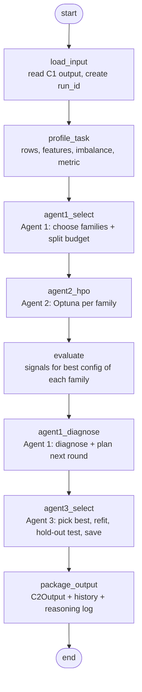

# C2 – Step 3 Guide: The LangGraph Workflow (One Round)

> This guide covers **Roadmap Step 3** (§8 and §13.1 F4 of [C2_IMPLEMENTATION_GUIDE.md](C2_IMPLEMENTATION_GUIDE.md)).
> It continues from [C2_SETUP_GUIDE_AGENT2.md](C2_SETUP_GUIDE_AGENT2.md). Steps 0–2 must be done first.
>
> At the end you will have:
> - **one command** that runs the whole C2 pipeline: load → profile → Agent 1 → Agent 2 → evaluate → diagnose → Agent 3 → output,
> - **Agent 3 Level 1** (choose the best model, test it once on the hold-out data, save it),
> - the official **`C2Output`** that C3 will receive, plus the saved model, search history and reasoning log,
> - 5 new tests (28 in total).
>
> Still **one round, rule-based, no LLM**. Step 4 adds the loop; Step 5 adds the LLM.

---

## Contents

- [1. What Step 3 builds](#1-what-step-3-builds)
- [2. LangGraph in 5 minutes](#2-langgraph-in-5-minutes)
- [3. Files in this step](#3-files-in-this-step)
- [4. Install LangGraph](#4-install-langgraph)
- [5. The output contract: `C2Output`](#5-the-output-contract-c2output)
- [6. Agent 3 – Level 1](#6-agent-3--level-1)
- [7. The state](#7-the-state)
- [8. The nodes](#8-the-nodes)
- [9. The graph](#9-the-graph)
- [10. The run script](#10-the-run-script)
- [11. Tests](#11-tests)
- [12. Run it](#12-run-it)
- [13. What the results tell you](#13-what-the-results-tell-you)
- [14. Commit, troubleshooting, next steps](#14-commit-troubleshooting-next-steps)

---

## 1. What Step 3 builds

Until now you ran Agent 1 and Agent 2 with **separate scripts**. Step 3 connects them into **one workflow**:



| Before Step 3 | After Step 3 |
|---|---|
| 3 separate scripts | 1 command: `python scripts/run_c2.py diabetes` |
| Agent 1 diagnosed **untuned** models | Agent 1 diagnoses the **tuned** models from Agent 2 |
| No final model | Agent 3 picks, refits, tests once on hold-out, saves `model.joblib` |
| Logs in different files | One `reasoning_log.json` with every decision from all 3 agents |
| No output for C3 | `c2_output.json` that follows the `C2Output` contract |

---

## 2. LangGraph in 5 minutes

You only need four ideas:

| Idea | Meaning | In C2 |
|---|---|---|
| **State** | One dictionary that flows through the graph | `C2State` in `state.py` |
| **Node** | A Python function: `node(state) -> dict of changes` | `nodes.py` – one function per step |
| **Edge** | "after node X, run node Y" | `graph.py` |
| **Reducer** | How a returned value is merged into the state. Default = **replace**. With `operator.add` = **append** | `reasoning_log`, `trial_rows` keep growing |

A node **returns only what it changes**. LangGraph merges it into the state:

```python
def agent1_select(state):
    families, entry = select_initial_families(...)
    return {"families": families,                 # replaces state["families"]
            "reasoning_log": [entry.model_dump()]} # APPENDED (operator.add)
```

Two important design rules in this project:

1. **Nodes are wiring, not ML.** Nodes call agents and tools you already tested. All ML logic stays in `agents/` and `tools/`.
2. **State holds only JSON-friendly values.** No DataFrames or models in the state: nodes load data from disk (cached) when they need it. This keeps the state easy to log, and lets you add a checkpointer later.

---

## 3. Files in this step

| File | New / changed | Purpose |
|---|---|---|
| `requirements.txt` | changed | add `langgraph` |
| `src/c2_automl/schemas.py` | changed | add `C2Output` |
| `src/c2_automl/tools/holdout.py` | new | final fit, hold-out metrics, save model |
| `src/c2_automl/agents/agent3_selection.py` | new | **Agent 3 Level 1** |
| `src/c2_automl/state.py` | new | graph state |
| `src/c2_automl/nodes.py` | new | one function per graph step |
| `src/c2_automl/graph.py` | new | builds the LangGraph graph |
| `scripts/run_c2.py` | new | run the whole workflow |
| `tests/test_graph.py` | new | 5 tests, including a full end-to-end run |

Tested with **LangGraph 1.2**, Optuna 5.0, scikit-learn 1.9, Python 3.11 and 3.13.

---

## 4. Install LangGraph

Add one line to **`requirements.txt`**:

```text
langgraph>=1.0
```

Full file:

```text
pandas>=2.2
numpy>=1.26
pyarrow>=15.0
openpyxl>=3.1
scikit-learn>=1.5
xgboost>=2.1
lightgbm>=4.5
catboost>=1.2.7
optuna>=4.0
pydantic>=2.7
pyyaml>=6.0
langgraph>=1.0
```

Install (venv active):

```bash
pip install -r requirements.txt
python -c "import langgraph; from langgraph.graph import StateGraph; print('langgraph OK')"
```

> `langchain-core` is installed automatically with LangGraph. You don't need an LLM provider package until Step 5.

---

## 5. The output contract: `C2Output`

This is **what C2 gives to C3**. Share it with your C3 teammate.

Add to the end of **`src/c2_automl/schemas.py`**:

```python
class C2Output(BaseModel):
    """What C2 gives to C3: the selected model plus all evidence and reasoning."""
    dataset_id: str
    run_id: str
    task_type: TaskType
    metric: str
    selected_model_path: str
    model_family: str
    hyperparameters: dict
    metrics_cv: dict[str, float]
    metrics_holdout: dict[str, float]
    model_size_kb: float
    latency_ms_per_1k: Optional[float] = None      # Agent 3 Level 2 (Step 6)
    pareto_front: list[dict] = []                  # Agent 3 Level 3 (Step 6)
    candidates: list[dict] = []                    # best result per family
    diagnoses: list[dict] = []
    search_history_path: str
    reasoning_log_path: str
    total_trials: int
    rounds: int
    referrals_to_c1: list[str] = []
```

| Field | Filled in | Notes |
|---|---|---|
| `selected_model_path`, `model_family`, `hyperparameters` | Step 3 | the chosen model |
| `metrics_cv` | Step 3 | CV score, train score, gap, cv_std of the chosen config |
| `metrics_holdout` | Step 3 | measured **once** on the test split |
| `model_size_kb` | Step 3 | size of `model.joblib` |
| `candidates`, `diagnoses` | Step 3 | best result + diagnosis of every family (for C3 and the audit) |
| `search_history_path`, `reasoning_log_path` | Step 3 | evidence files |
| `latency_ms_per_1k`, `pareto_front` | Step 6 | Agent 3 Levels 2–3; empty for now |

---

## 6. Agent 3 – Level 1

**Goal:** choose the family with the best CV score, refit it on **all** training data, test it **once** on the hold-out split, and save it.

### 6.1 Trusted tool: `tools/holdout.py`

```python
"""Final fit + one-time hold-out evaluation (trusted tool). Only Agent 3 calls this, once per run."""
from pathlib import Path

import joblib
import numpy as np
import pandas as pd
from sklearn.metrics import (accuracy_score, f1_score, mean_absolute_error, precision_score,
                             r2_score, recall_score, roc_auc_score, root_mean_squared_error)

from ..schemas import TaskType
from .models import make_model


def holdout_metrics(model, X_test: pd.DataFrame, y_test: pd.Series, task_type: TaskType) -> dict:
    if task_type == TaskType.REGRESSION:
        pred = model.predict(X_test)
        return {"rmse": float(root_mean_squared_error(y_test, pred)),
                "mae": float(mean_absolute_error(y_test, pred)),
                "r2": float(r2_score(y_test, pred))}

    pred = np.ravel(model.predict(X_test))
    proba = model.predict_proba(X_test)
    metrics = {"accuracy": float(accuracy_score(y_test, pred))}
    if task_type == TaskType.BINARY:
        metrics.update({
            "roc_auc": float(roc_auc_score(y_test, proba[:, 1])),
            "f1": float(f1_score(y_test, pred)),
            "precision": float(precision_score(y_test, pred, zero_division=0)),
            "recall": float(recall_score(y_test, pred)),
        })
    else:
        metrics.update({
            "f1_macro": float(f1_score(y_test, pred, average="macro")),
            "roc_auc_ovr": float(roc_auc_score(y_test, proba, multi_class="ovr")),
        })
    return metrics


def fit_final_model(family: str, params: dict, X_train: pd.DataFrame, y_train: pd.Series,
                    task_type: TaskType, seed: int):
    """Refit the chosen configuration on ALL training data."""
    model = make_model(family, task_type, params, seed)
    model.fit(X_train, y_train)
    return model


def save_model(model, path: Path) -> float:
    """Save with joblib; returns the file size in KB (a simple complexity measure)."""
    path.parent.mkdir(parents=True, exist_ok=True)
    joblib.dump(model, path)
    return round(path.stat().st_size / 1024, 1)
```

### 6.2 The agent: `agents/agent3_selection.py`

```python
"""Agent 3 - Multi-Objective Selection.

Level 1 (this step): choose the family with the best CV score.
Level 2-3 (Step 6) will add latency, model size, constraints and the Pareto front.
"""
from ..schemas import ReasoningEntry


def select_best(candidates: dict[str, dict], round_no: int) -> tuple[str, ReasoningEntry]:
    """candidates: family -> best trial row (needs 'mean_val'). Higher mean_val is better."""
    if not candidates:
        raise ValueError("Agent 3 received no candidates (every trial failed or was pruned)")
    ranking = sorted(candidates.items(), key=lambda kv: kv[1]["mean_val"], reverse=True)
    winner, best = ranking[0]
    runner_up = ranking[1] if len(ranking) > 1 else None

    rationale = f"{winner} has the best CV score ({best['mean_val']:.4f})"
    if runner_up:
        margin = best["mean_val"] - runner_up[1]["mean_val"]
        rationale += f", {margin:.4f} ahead of {runner_up[0]}"

    entry = ReasoningEntry(
        round=round_no, agent="agent3", step="select_best",
        decision={"selected_family": winner, "params": best["params"]},
        evidence={f: round(c["mean_val"], 4) for f, c in ranking},
        rationale=rationale + " (Level 1: score only; latency/size come in Step 6)")
    return winner, entry
```

> **Why only the CV score decides:** the hold-out test set is **never** used to choose. It is used once, after the choice, to report an honest score. If you chose using the test set, the reported score would be too optimistic (data leakage).

---

## 7. The state

**`src/c2_automl/state.py`**

```python
"""The shared state that flows through the LangGraph workflow.

Rules:
- Only JSON-friendly values (str, int, float, list, dict). DataFrames and models are NOT stored
  here; nodes load data from disk when needed. This keeps the state easy to log and checkpoint.
- Fields marked `operator.add` are APPENDED to by each node instead of replaced.
"""
import operator
from typing import Annotated, Optional, TypedDict


class C2State(TypedDict, total=False):
    # input
    dataset_id: str
    total_trials: int
    folds: int

    # set by load_input / profile_task
    run_id: str
    cfg: dict
    c1: dict                                  # C1Output as dict
    profile: dict                             # TaskProfile as dict
    round: int

    # Agent 1 -> Agent 2
    families: list[str]
    budget: dict[str, int]

    # Agent 2 -> evaluate
    trial_rows: Annotated[list[dict], operator.add]   # full search history (all rounds)
    candidates: dict[str, dict]                        # best trial per family (this round)

    # evaluate -> Agent 1 diagnose
    signals: dict[str, dict]

    # Agent 1 diagnose -> router / Agent 3
    diagnoses: list[dict]
    plan: dict
    referrals_to_c1: Annotated[list[str], operator.add]
    stop_reason: Optional[str]

    # Agent 3 -> package_output
    selection: dict

    # every node adds its decisions here (auditable reasoning)
    reasoning_log: Annotated[list[dict], operator.add]

    # final result
    output: dict
```

Who writes what:

| Field | Written by | Read by |
|---|---|---|
| `dataset_id`, `total_trials`, `folds` | you (input) | `load_input` |
| `cfg`, `c1`, `run_id`, `round` | `load_input` | all nodes |
| `profile` | `profile_task` | Agent 1, Agent 2, evaluate |
| `families`, `budget` | `agent1_select` | `agent2_hpo` |
| `trial_rows` (append), `candidates` | `agent2_hpo` | evaluate, Agent 3, package |
| `signals` | `evaluate` | `agent1_diagnose` |
| `diagnoses`, `plan`, `referrals_to_c1`, `stop_reason` | `agent1_diagnose` | package (Step 4: the router) |
| `selection` | `agent3_select` | `package_output` |
| `reasoning_log` (append) | every agent node | `package_output` |
| `output` | `package_output` | you / C3 |

---

## 8. The nodes

**`src/c2_automl/nodes.py`**

```python
"""LangGraph nodes. Each node: read what it needs from the state, call an agent or tool,
return ONLY the fields it changes. Nodes contain wiring, not ML logic."""
import json
from functools import lru_cache

import pandas as pd

from . import config
from .agents.agent1_generation import diagnose_family, plan_next_round, select_initial_families
from .agents.agent2_hpo import new_run_id, run_hpo, save_history, split_budget
from .agents.agent3_selection import select_best
from .io.dummy_c1 import load_c1_output, load_split
from .schemas import C1Output, C2Output, ReasoningEntry, TaskProfile
from .tools.holdout import fit_final_model, holdout_metrics, save_model
from .tools.signals import compute_signals
from .tools.task_profile import profile_task as compute_profile
from .tools.train_eval import baseline_score, cross_validate_family


# ---------- helpers ----------
def _c1(state) -> C1Output:
    return C1Output(**state["c1"])


@lru_cache(maxsize=8)
def _cached_split(c1_json: str, split: str) -> tuple[pd.DataFrame, pd.Series]:
    return load_split(C1Output.model_validate_json(c1_json), split)


def _data(state, split: str = "train"):
    return _cached_split(_c1(state).model_dump_json(), split)


def _run_dir(state):
    return config.OUTPUT_DIR / state["dataset_id"] / state["run_id"]


# ---------- nodes ----------
def load_input(state):
    cfg = config.load_default_config()
    cfg["cv_folds"] = state.get("folds") or cfg["cv_folds"]
    c1 = load_c1_output(state["dataset_id"])
    return {"cfg": cfg, "c1": c1.model_dump(mode="json"), "round": 1,
            "run_id": new_run_id(state["dataset_id"], "c2"),
            "total_trials": state.get("total_trials") or cfg["budget"]["total_trials"]}


def profile_task(state):
    X, y = _data(state)
    profile = compute_profile(_c1(state), X, y, state["cfg"])
    return {"profile": profile.model_dump()}


def agent1_select(state):
    registry = config.load_yaml("model_registry.yaml")
    families, entry = select_initial_families(TaskProfile(**state["profile"]), _c1(state),
                                              registry, state["cfg"])
    budget = split_budget(state["total_trials"], families)
    entry.decision["budget"] = budget
    return {"families": families, "budget": budget, "reasoning_log": [entry.model_dump()]}


def agent2_hpo(state):
    X, y = _data(state)
    cfg = state["cfg"]
    rows, best, entry = run_hpo(state["families"], state["budget"], X, y, _c1(state),
                                TaskProfile(**state["profile"]), cfg, state["run_id"],
                                method=cfg["hpo"]["method"], round_no=state["round"])
    return {"trial_rows": rows, "candidates": best, "reasoning_log": [entry.model_dump()]}


def evaluate(state):
    """Re-run CV once with each family's best params to collect diagnosis signals."""
    X, y = _data(state)
    c1, cfg, metric = _c1(state), state["cfg"], state["profile"]["metric"]
    base = baseline_score(X, y, c1.task_type, metric, cfg["cv_folds"], cfg["seed"])
    results = {f: cross_validate_family(f, X, y, c1.task_type, metric, cfg["cv_folds"],
                                        cfg["seed"], params=cand["params"])
               for f, cand in state["candidates"].items()}
    best_val = max(r["mean_val"] for r in results.values())
    signals = {f: compute_signals(r, y, c1.task_type, base, best_val, c1.fqs)
               for f, r in results.items()}
    return {"signals": signals}


def agent1_diagnose(state):
    rules = config.load_yaml("diagnosis_rules.yaml")
    diagnoses = [diagnose_family(f, s, rules) for f, s in state["signals"].items()]
    plan, plan_entry = plan_next_round(diagnoses, rules, state["round"])

    log = [ReasoningEntry(round=state["round"], agent="agent1", step="diagnose",
                          decision={"family": d.model_family, "labels": [l.value for l in d.labels]},
                          evidence=d.evidence, rationale="; ".join(d.reasons)).model_dump()
           for d in diagnoses]
    log.append(plan_entry.model_dump())

    # Step 3 = one round only. Step 4 replaces this with a real stop/continue decision.
    stop_reason = "weak_features" if plan.stop else "single_round (adaptive loop comes in Step 4)"
    return {"diagnoses": [d.model_dump(mode="json") for d in diagnoses],
            "plan": plan.model_dump(), "referrals_to_c1": plan.referrals_to_c1,
            "stop_reason": stop_reason, "reasoning_log": log}


def agent3_select(state):
    c1, cfg = _c1(state), state["cfg"]
    winner, entry = select_best(state["candidates"], state["round"])
    best = state["candidates"][winner]

    X, y = _data(state, "train")
    model = fit_final_model(winner, best["params"], X, y, c1.task_type, cfg["seed"])
    X_test, y_test = _data(state, "test")               # the ONLY place the test split is used
    metrics_holdout = holdout_metrics(model, X_test, y_test, c1.task_type)
    model_path = _run_dir(state) / "model.joblib"
    size_kb = save_model(model, model_path)

    selection = {
        "family": winner, "params": best["params"], "model_path": str(model_path),
        "model_size_kb": size_kb, "metrics_holdout": metrics_holdout,
        "metrics_cv": {state["profile"]["metric"]: best["mean_val"], "mean_train": best["mean_train"],
                       "gap": best["gap"], "cv_std": best["cv_std"]},
    }
    entry.evidence["holdout"] = metrics_holdout
    return {"selection": selection, "reasoning_log": [entry.model_dump()]}


def package_output(state):
    run_dir = _run_dir(state)
    history_path = run_dir / "search_history.parquet"
    log_path = run_dir / "reasoning_log.json"
    save_history(state["trial_rows"], history_path)
    log_path.write_text(json.dumps(state["reasoning_log"], indent=2, default=str))

    sel, c1 = state["selection"], _c1(state)
    output = C2Output(
        dataset_id=state["dataset_id"], run_id=state["run_id"], task_type=c1.task_type,
        metric=state["profile"]["metric"], selected_model_path=sel["model_path"],
        model_family=sel["family"], hyperparameters=sel["params"],
        metrics_cv=sel["metrics_cv"], metrics_holdout=sel["metrics_holdout"],
        model_size_kb=sel["model_size_kb"],
        candidates=[{"family": f, "mean_val": c["mean_val"], "gap": c["gap"], "params": c["params"],
                     "n_complete": c["n_complete"], "n_pruned": c["n_pruned"]}
                    for f, c in state["candidates"].items()],
        diagnoses=state["diagnoses"], search_history_path=str(history_path),
        reasoning_log_path=str(log_path), total_trials=len(state["trial_rows"]),
        rounds=state["round"], referrals_to_c1=state.get("referrals_to_c1", []),
    )
    (run_dir / "c2_output.json").write_text(output.model_dump_json(indent=2))
    return {"output": output.model_dump(mode="json")}
```

| Node | Calls | Notes |
|---|---|---|
| `load_input` | `load_c1_output` | creates `run_id` like `diabetes_c2_20261016_170717` |
| `profile_task` | `tools/task_profile.py` | |
| `agent1_select` | Agent 1 Level 2 + `split_budget` | equal budget for now |
| `agent2_hpo` | Agent 2 Levels 2–3 | uses `hpo.method` from the config (`tpe`) |
| `evaluate` | `cross_validate_family` + `compute_signals` | one extra CV run per family, with its **best** params, to get out-of-fold predictions for minority recall |
| `agent1_diagnose` | Agent 1 Level 3 | sets `stop_reason`; one round only in Step 3 |
| `agent3_select` | **Agent 3 Level 1** | the only node that reads the **test** split |
| `package_output` | `C2Output` | saves `c2_output.json`, `search_history.parquet`, `reasoning_log.json` |

`_cached_split` uses `lru_cache`, so each split is read from disk only once per run, even though several nodes need it.

---

## 9. The graph

**`src/c2_automl/graph.py`**

```python
"""The C2 workflow as a LangGraph graph (Step 3: one round, rule-based, no LLM)."""
from langgraph.graph import END, START, StateGraph

from . import nodes
from .state import C2State


def build_graph():
    g = StateGraph(C2State)

    g.add_node("load_input", nodes.load_input)
    g.add_node("profile_task", nodes.profile_task)
    g.add_node("agent1_select", nodes.agent1_select)
    g.add_node("agent2_hpo", nodes.agent2_hpo)
    g.add_node("evaluate", nodes.evaluate)
    g.add_node("agent1_diagnose", nodes.agent1_diagnose)
    g.add_node("agent3_select", nodes.agent3_select)
    g.add_node("package_output", nodes.package_output)

    g.add_edge(START, "load_input")
    g.add_edge("load_input", "profile_task")
    g.add_edge("profile_task", "agent1_select")
    g.add_edge("agent1_select", "agent2_hpo")
    g.add_edge("agent2_hpo", "evaluate")
    g.add_edge("evaluate", "agent1_diagnose")
    # Step 4 replaces this edge with a conditional edge:
    #   agent1_diagnose -> (next round) agent2_hpo   OR   (stop) agent3_select
    g.add_edge("agent1_diagnose", "agent3_select")
    g.add_edge("agent3_select", "package_output")
    g.add_edge("package_output", END)

    return g.compile()
```

The edge `agent1_diagnose → agent3_select` is a plain edge for now. In **Step 4** it becomes a **conditional edge**: if Agent 1 says "continue", the graph goes back to Agent 2 with adapted ranges. If it says "stop", the graph goes on to Agent 3. That loop is your core novelty.

---

## 10. The run script

**`scripts/run_c2.py`** – streams the graph and prints one line per node, so you can watch the agents work:

```python
"""Run the whole C2 workflow (LangGraph) on one dataset and show what each node did.

Usage:
  python scripts/run_c2.py diabetes --trials 30
  python scripts/run_c2.py adult --trials 60 --folds 3
  python scripts/run_c2.py diabetes --draw          # print the graph as Mermaid and exit
"""
import argparse

from c2_automl.graph import build_graph


def show(node: str, update: dict) -> None:
    """Print a one-line summary of each node's update."""
    if node == "load_input":
        print(f"[load_input]      run_id={update['run_id']}  total_trials={update['total_trials']}")
    elif node == "profile_task":
        p = update["profile"]
        print(f"[profile_task]    {p['n_rows']} rows, {p['n_features']} features, "
              f"size={p['size_class']}, metric={p['metric']}, imbalance={p['imbalance_ratio']}")
    elif node == "agent1_select":
        print(f"[agent1_select]   families={update['families']}  budget={update['budget']}")
        print(f"                  reason: {update['reasoning_log'][0]['rationale']}")
    elif node == "agent2_hpo":
        for f, c in update["candidates"].items():
            print(f"[agent2_hpo]      {f:<20} best={c['mean_val']:.4f} gap={c['gap']:.3f} "
                  f"(complete={c['n_complete']}, pruned={c['n_pruned']})")
    elif node == "evaluate":
        print(f"[evaluate]        signals computed for {list(update['signals'])}")
    elif node == "agent1_diagnose":
        for d in update["diagnoses"]:
            print(f"[agent1_diagnose] {d['model_family']:<20} {d['labels']}")
        print(f"                  plan: keep={update['plan']['families_next_round']}")
        if update["referrals_to_c1"]:
            print(f"                  referrals to C1: {update['referrals_to_c1']}")
        print(f"                  stop_reason: {update['stop_reason']}")
    elif node == "agent3_select":
        s = update["selection"]
        hold = ", ".join(f"{k}={v:.4f}" for k, v in s["metrics_holdout"].items())
        print(f"[agent3_select]   selected {s['family']}  -> hold-out: {hold}")
        print(f"                  reason: {update['reasoning_log'][0]['rationale']}")
    elif node == "package_output":
        o = update["output"]
        print(f"[package_output]  model: {o['selected_model_path']} ({o['model_size_kb']} KB)")
        print(f"                  c2_output.json, search_history.parquet ({o['total_trials']} trials), "
              f"reasoning_log.json saved")


def main():
    parser = argparse.ArgumentParser()
    parser.add_argument("dataset_id")
    parser.add_argument("--trials", type=int, default=None, help="total trial budget")
    parser.add_argument("--folds", type=int, default=None)
    parser.add_argument("--draw", action="store_true", help="print the graph as Mermaid")
    args = parser.parse_args()

    graph = build_graph()
    if args.draw:
        print(graph.get_graph().draw_mermaid())
        return

    inputs = {"dataset_id": args.dataset_id, "total_trials": args.trials, "folds": args.folds}
    # stream_mode="updates" yields {node_name: update} after every node finishes
    for step in graph.stream(inputs, stream_mode="updates"):
        for node, update in step.items():
            show(node, update)


if __name__ == "__main__":
    main()
```

`graph.stream(inputs, stream_mode="updates")` gives you each node's changes as soon as the node finishes. `graph.invoke(inputs)` (used in the tests) runs everything and returns the final state.

---

## 11. Tests

**`tests/test_graph.py`**

```python
import json
from pathlib import Path

import pandas as pd
import pytest
from sklearn.datasets import make_classification

from c2_automl.agents.agent3_selection import select_best
from c2_automl.graph import build_graph
from c2_automl.schemas import C2Output, TaskType
from c2_automl.tools.holdout import fit_final_model, holdout_metrics

EXPECTED_NODES = ["load_input", "profile_task", "agent1_select", "agent2_hpo", "evaluate",
                  "agent1_diagnose", "agent3_select", "package_output"]


# ---------- graph structure ----------
def test_graph_has_all_nodes():
    nodes = set(build_graph().get_graph().nodes)
    assert set(EXPECTED_NODES) <= nodes


# ---------- Agent 3 Level 1 ----------
def test_select_best_picks_highest_cv_score():
    candidates = {"a": {"mean_val": 0.80, "params": {}}, "b": {"mean_val": 0.85, "params": {"x": 1}}}
    winner, entry = select_best(candidates, round_no=1)
    assert winner == "b"
    assert "0.0500 ahead of a" in entry.rationale


def test_select_best_without_candidates_raises():
    with pytest.raises(ValueError):
        select_best({}, round_no=1)


def test_holdout_metrics_binary():
    X, y = make_classification(n_samples=200, n_features=5, random_state=0)
    X, y = pd.DataFrame(X), pd.Series(y)
    model = fit_final_model("logistic_regression", {}, X[:150], y[:150], TaskType.BINARY, seed=0)
    m = holdout_metrics(model, X[150:], y[150:], TaskType.BINARY)
    assert set(m) == {"accuracy", "roc_auc", "f1", "precision", "recall"}


# ---------- end-to-end (small synthetic dataset, temporary folders) ----------
@pytest.fixture
def tmp_project(tmp_path, monkeypatch):
    """Redirect data and outputs to a temp folder so the test never touches real files."""
    import c2_automl.agents.agent2_hpo as agent2
    import c2_automl.config as config
    import c2_automl.io.dummy_c1 as dummy_c1
    monkeypatch.setattr(dummy_c1, "DATA_DIR", tmp_path / "data")
    monkeypatch.setattr(config, "OUTPUT_DIR", tmp_path / "outputs")
    monkeypatch.setattr(agent2, "OUTPUT_DIR", tmp_path / "outputs")

    X, y = make_classification(n_samples=300, n_features=6, weights=[0.7], random_state=0)
    df = pd.DataFrame(X, columns=[f"f{i}" for i in range(6)])
    df["target"] = y
    dummy_c1.build_dummy_c1(df, "target", TaskType.BINARY, dataset_id="tiny")
    return tmp_path


def test_full_workflow_end_to_end(tmp_project):
    final = build_graph().invoke({"dataset_id": "tiny", "total_trials": 6, "folds": 3})

    out = C2Output(**final["output"])                  # output matches the contract
    assert out.total_trials == 6 and out.rounds == 1
    assert out.model_family in final["families"]
    assert "roc_auc" in out.metrics_holdout
    for path in (out.selected_model_path, out.search_history_path, out.reasoning_log_path):
        assert Path(path).exists()

    agents = {e["agent"] for e in json.loads(Path(out.reasoning_log_path).read_text())}
    assert agents == {"agent1", "agent2", "agent3"}
```

The end-to-end test builds a tiny synthetic dataset in a **temporary folder** (`monkeypatch` redirects `DATA_DIR` and `OUTPUT_DIR`), runs the whole graph with 6 trials, and checks that:
- the output passes the `C2Output` contract,
- the model, history and log files exist,
- all three agents wrote to the reasoning log.

```bash
pytest -q
```

Expected:

```text
............................                                             [100%]
28 passed
```

---

## 12. Run it

### 12.1 Pima Diabetes

```bash
python scripts/run_c2.py diabetes --trials 30
```

Actual output from testing this guide (about 20 seconds):

```text
[load_input]      run_id=diabetes_c2_20261016_171022  total_trials=30
[profile_task]    614 rows, 8 features, size=small, metric=roc_auc, imbalance=0.535
[agent1_select]   families=['random_forest', 'catboost', 'logistic_regression']  budget={'random_forest': 10, 'catboost': 10, 'logistic_regression': 10}
                  reason: small dataset (614 rows): boosting overfits easily, prefer random forest, catboost and a simple baseline
[agent2_hpo]      random_forest        best=0.8315 gap=0.100 (complete=10, pruned=0)
[agent2_hpo]      catboost             best=0.8312 gap=0.135 (complete=9, pruned=1)
[agent2_hpo]      logistic_regression  best=0.8348 gap=0.007 (complete=8, pruned=2)
[evaluate]        signals computed for ['random_forest', 'catboost', 'logistic_regression']
[agent1_diagnose] random_forest        ['healthy']
[agent1_diagnose] catboost             ['overfitting']
[agent1_diagnose] logistic_regression  ['healthy']
                  plan: keep=['random_forest', 'catboost', 'logistic_regression']
                  stop_reason: single_round (adaptive loop comes in Step 4)
[agent3_select]   selected logistic_regression  -> hold-out: accuracy=0.7208, roc_auc=0.8215, f1=0.5567, precision=0.6279, recall=0.5000
                  reason: logistic_regression has the best CV score (0.8348), 0.0033 ahead of random_forest (Level 1: score only; latency/size come in Step 6)
[package_output]  model: outputs/diabetes/diabetes_c2_20261016_171022/model.joblib (1.9 KB)
                  c2_output.json, search_history.parquet (30 trials), reasoning_log.json saved
```

### 12.2 Imbalanced Adult

```bash
python scripts/run_c2.py adult_imbalanced --trials 60 --folds 3
```

Actual output (about 75 seconds):

```text
[load_input]      run_id=adult_imbalanced_c2_20261016_171040  total_trials=60
[profile_task]    30643 rows, 14 features, size=medium, metric=roc_auc, imbalance=0.0309
[agent1_select]   families=['random_forest', 'xgboost', 'lightgbm', 'catboost']  budget={'random_forest': 15, 'xgboost': 15, 'lightgbm': 15, 'catboost': 15}
                  reason: medium dataset (30643 rows): default tree-based families; 57% categorical features: add catboost
[agent2_hpo]      random_forest        best=0.9100 gap=0.044 (complete=11, pruned=4)
[agent2_hpo]      xgboost              best=0.9200 gap=0.038 (complete=9, pruned=6)
[agent2_hpo]      lightgbm             best=0.9188 gap=0.051 (complete=12, pruned=3)
[agent2_hpo]      catboost             best=0.9215 gap=0.024 (complete=12, pruned=3)
[evaluate]        signals computed for ['random_forest', 'xgboost', 'lightgbm', 'catboost']
[agent1_diagnose] random_forest        ['class_imbalance']
[agent1_diagnose] xgboost              ['class_imbalance']
[agent1_diagnose] lightgbm             ['overfitting', 'class_imbalance']
[agent1_diagnose] catboost             ['class_imbalance']
                  plan: keep=['random_forest', 'xgboost', 'lightgbm', 'catboost']
                  referrals to C1: ['class_imbalance: consider resampling (e.g. SMOTE/ADASYN) in C1']
                  stop_reason: single_round (adaptive loop comes in Step 4)
[agent3_select]   selected catboost  -> hold-out: accuracy=0.9768, roc_auc=0.9207, f1=0.4027, precision=0.8824, recall=0.2609
                  reason: catboost has the best CV score (0.9215), 0.0015 ahead of xgboost (Level 1: score only; latency/size come in Step 6)
[package_output]  model: outputs/adult_imbalanced/adult_imbalanced_c2_20261016_171040/model.joblib (72.4 KB)
                  c2_output.json, search_history.parquet (60 trials), reasoning_log.json saved
```

### 12.3 What is saved

Each run gets its own folder:

```text
outputs/<dataset>/<run_id>/
├── model.joblib              # the selected model (load with joblib.load)
├── c2_output.json            # the C2Output contract -> goes to C3
├── search_history.parquet    # every Optuna trial (complete + pruned)
└── reasoning_log.json        # every decision by Agent 1, 2, 3 with evidence
```

Part of `c2_output.json` (imbalanced Adult):

```json
{
  "dataset_id": "adult_imbalanced",
  "run_id": "adult_imbalanced_c2_20261016_171040",
  "task_type": "binary",
  "metric": "roc_auc",
  "model_family": "catboost",
  "hyperparameters": {
    "iterations": 341,
    "depth": 3,
    "learning_rate": 0.09824791090527077,
    "l2_leaf_reg": 1.0045736914093704
  },
  "metrics_cv": {
    "roc_auc": 0.921505054781437,
    "mean_train": 0.9452818109207861,
    "gap": 0.023776756139349153,
    "cv_std": 0.005391028016722098
  },
  "metrics_holdout": {
    "accuracy": 0.9767654353217595,
    "roc_auc": 0.9207254568113601,
    "f1": 0.40268456375838924,
    "precision": 0.8823529411764706,
    "recall": 0.2608695652173913
  },
  "model_size_kb": 72.4,
  "total_trials": 60,
  "rounds": 1,
  "referrals_to_c1": [
    "class_imbalance: consider resampling (e.g. SMOTE/ADASYN) in C1"
  ],
  "selected_model_path": "outputs/adult_imbalanced/adult_imbalanced_c2_20261016_171040/model.joblib"
}
```

Use the saved model:

```python
import joblib
from c2_automl.io.dummy_c1 import load_c1_output, load_split

model = joblib.load("outputs/diabetes/<run_id>/model.joblib")
X_test, y_test = load_split(load_c1_output("diabetes"), "test")
model.predict_proba(X_test)[:5]
```

### 12.4 Draw the graph (for the thesis)

```bash
python scripts/run_c2.py diabetes --draw
```

This prints the graph as **Mermaid** text. Paste it into https://mermaid.live to export a PNG/SVG figure.

---

## 13. What the results tell you

| # | Observation | Evidence | Meaning |
|---|---|---|---|
| 1 | Agent 1 now diagnoses **tuned** models, so the diagnoses change | Pima Random Forest: overfitting with defaults (gap 0.189) → **healthy** after tuning (gap 0.100, train 0.931 < 0.95 threshold) | Diagnosis must run **after** each tuning round, which is exactly where the Step 4 loop will run it |
| 2 | **High accuracy can hide a bad model** | Imbalanced Adult hold-out: accuracy **0.977**, ROC-AUC 0.921, but **recall 0.26**: it misses 3 out of 4 positive cases | Agent 1 correctly diagnoses `class_imbalance` for every family and refers it to C1. In Step 4, Agent 2 will act on it (`enable_class_weights`) |
| 3 | Agent 1 plans, but nothing happens yet | `plan: keep=[...]`, `stop_reason: single_round` | The plan is ready for Step 4. Today Agent 3 just picks the best CV score |
| 4 | Score-only selection picks by tiny margins | Pima: logistic regression wins by 0.0033 | Agent 3 Levels 2–3 (Step 6) will also weigh latency and size: a tiny accuracy gain may not be worth a slower, bigger model |

---

## 14. Commit, troubleshooting, next steps

### Commit

```bash
git add components/C2-Agentic-AutoML
git commit -m "C2: LangGraph workflow (one round) + Agent 3 level 1 + C2Output"
```

### Troubleshooting

| Problem | Fix |
|---|---|
| `ModuleNotFoundError: No module named 'langgraph'` | `pip install -r requirements.txt` with the venv active |
| `ImportError: cannot import name 'C2Output'` | Add `C2Output` to `schemas.py` (section 5) |
| `ValueError: Agent 3 received no candidates` | Every trial of every family was pruned or failed; use a larger `--trials` |
| `FileNotFoundError: ... manifest.json` | Run `python scripts/build_dummy_data.py` |
| `ValueError: budget ... smaller than the number of families` | `--trials` must be at least the number of families Agent 1 picks (3–4) |
| Slow on Adult | Use `--folds 3` and fewer `--trials` while developing |

### Next steps

| Next | What | Main guide |
|---|---|---|
| **Step 4** ⭐ **(core novelty)** | **Agent 2 Level 4**: `adapt_space()` turns Agent 1's actions into new ranges. **Agent 1 Level 4**: conditional edge + multi-round loop + stop rules + budget per round | §10.5, §11.2, §13.2–13.3 |
| Step 5 | Bounded LLM inside `agent1_diagnose` (rules stay as fallback) | §9 |
| Step 6 | Agent 3 Levels 2–4: latency, size, constraints, Pareto front | §12 |
