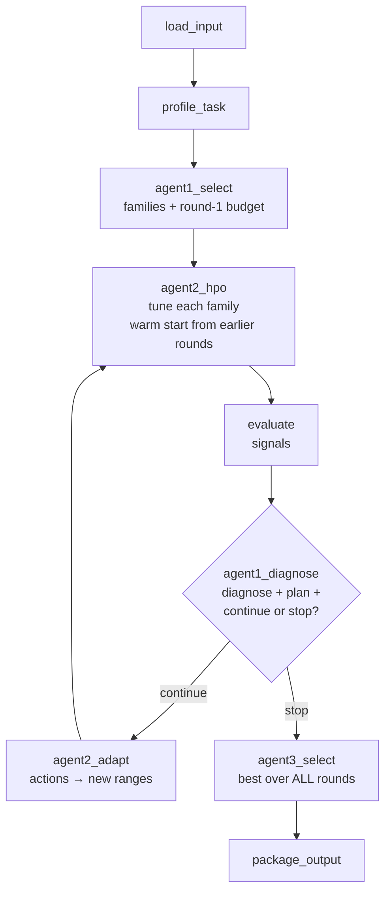

# C2 – Step 4 Guide: The Adaptive Loop ⭐ (Agent 1 Level 4 + Agent 2 Level 4)

> This guide covers **Roadmap Step 4**, the **core novelty** of C2 (§2, §10.5, §11.2, §13.2–13.3 of [C2_IMPLEMENTATION_GUIDE.md](C2_IMPLEMENTATION_GUIDE.md)).
> It continues from [C2_SETUP_GUIDE_STEP3.md](C2_SETUP_GUIDE_STEP3.md). Steps 0–3 must be done first.
>
> At the end you will have:
> - **Agent 2 Level 4**: `adapt_space()` turns Agent 1's diagnosis into **new search ranges** (within hard limits), plus a **warm start** so each round builds on the previous one,
> - **Agent 1 Level 4**: the **loop control** – budget per round and the **continue / stop** decision,
> - a LangGraph graph with a real **loop**: diagnose → adapt → tune again,
> - **ablation switches** to measure what each part contributes,
> - a **comparison script**: static baseline B2 vs. your adaptive method, same trial budget,
> - 22 new tests (52 in total).

---

## Contents

- [1. What changes in Step 4](#1-what-changes-in-step-4)
- [2. Files in this step](#2-files-in-this-step)
- [3. Config](#3-config)
- [4. Agent 2 Level 4 – adaptive search ranges](#4-agent-2-level-4--adaptive-search-ranges)
- [5. Warm start between rounds](#5-warm-start-between-rounds)
- [6. Agent 1 Level 4 – loop control](#6-agent-1-level-4--loop-control)
- [7. The graph with the loop](#7-the-graph-with-the-loop)
- [8. Schemas and state](#8-schemas-and-state)
- [9. Scripts](#9-scripts)
- [10. Tests](#10-tests)
- [11. Run it](#11-run-it)
- [12. Compare with the baseline (first thesis evidence)](#12-compare-with-the-baseline-first-thesis-evidence)
- [13. What the results tell you – honestly](#13-what-the-results-tell-you--honestly)
- [14. Commit, troubleshooting, next steps](#14-commit-troubleshooting-next-steps)

---

## 1. What changes in Step 4

In Step 3 the workflow was a straight line: Agent 1 diagnosed problems, but nobody acted on the diagnosis. Step 4 closes the loop:



One round, step by step (real example from Pima Diabetes, section 11):

| Who | Does what | Example |
|---|---|---|
| Agent 2 | tunes CatBoost in the base ranges | best ROC-AUC 0.8312, train-val gap 0.135 |
| Agent 1 | diagnoses | `overfitting` (gap 0.135 > 0.05, train 0.97 > 0.95) |
| Agent 1 | plans actions | `shrink_depth_range`, `increase_regularization` |
| Agent 1 | decides | `continue to round 2` |
| Agent 2 | adapts the ranges | `depth.high 8 → 6`, `l2_leaf_reg 1–10 → 2–20` |
| Agent 2 | tunes again (warm start) | best 0.8355, gap **0.091** – less overfitting, better score |

That chain – **evidence → named diagnosis → specific range change → measured effect**, all logged – is the novelty you defend in the viva.

---

## 2. Files in this step

| File | New / changed | What changes |
|---|---|---|
| `configs/default.yaml` | changed | `max_rounds: 3`, new `adaptive` section |
| `configs/space_adaptation.yaml` | **new** | what each action does to which parameter + hard limits + edge rule |
| `src/c2_automl/tools/search_space.py` | changed | `adapt_space`, `range_edge_hits`, warm-start helpers |
| `src/c2_automl/tools/hpo.py` | changed | `prior_trials` warm start; warm-start trials not counted |
| `src/c2_automl/agents/agent2_hpo.py` | changed | warm start in `run_hpo`; new `adapt_spaces` (Level 4) |
| `src/c2_automl/agents/agent1_generation.py` | changed | new `round_budget`, `decide_next_round` (Level 4) |
| `src/c2_automl/schemas.py` | changed | `C2Output.score_by_round`, `C2Output.stop_reason` |
| `src/c2_automl/state.py` | changed | `overrides`, `spaces`, `round_candidates`, `best_history` |
| `src/c2_automl/nodes.py` | changed | loop logic, new `agent2_adapt` node, router |
| `src/c2_automl/graph.py` | changed | conditional edge = the loop |
| `scripts/run_c2.py` | changed | shows rounds and range changes; ablation flags |
| `scripts/compare_adaptive.py` | **new** | B2 vs adaptive vs ablations |
| `tests/test_adaptive.py` | **new** | 22 tests |
| `tests/test_graph.py` | changed | single-round test + multi-round loop test |

No new libraries.

---

## 3. Config

### 3.1 `configs/default.yaml`

Change `max_rounds` to **3** and add the `adaptive` section at the end:

```yaml
# Trial budget for one C2 run (shared by all families and rounds)
budget:
  total_trials: 150
  max_rounds: 3

# Agent 2 - hyperparameter optimization
hpo:
  method: tpe               # tpe = Baseline B2, random = Baseline B1
  pruning: true             # stop clearly bad trials after a few CV folds

# Agent 1 Level 4 + Agent 2 Level 4 - the adaptive loop
adaptive:
  adapt_ranges: true        # false = ablation "no range adaptation"
  adapt_families: true      # false = ablation "never drop a family"
  min_improvement: 0.0005   # stop when the best score improves less than this in a round
```

| Setting | Meaning |
|---|---|
| `max_rounds: 3` | at most 3 tuning rounds |
| `total_trials` | shared by all rounds: each round gets `remaining ÷ rounds left` |
| `adapt_ranges: false` | ablation – loop runs but ranges never change |
| `adapt_families: false` | ablation – loop runs but no family is ever dropped |
| `min_improvement` | stop early ("converged") if the best score improved less than this in a round |

### 3.2 `configs/space_adaptation.yaml` (new)

This file is the **"knowledge" of Agent 2 Level 4**: for each action from Agent 1, which parameters move, and how much. Because it is data, you can tune and justify it in your thesis without touching code.

```yaml
# Agent 2 Level 4 - how Agent 1's actions change the search ranges.
# Multipliers are applied to the CURRENT range, so repeated actions keep moving it.
# A parameter that a family does not have is simply skipped.

actions:
  shrink_depth_range:            # overfitting -> simpler trees
    max_depth:  {high: 0.6}
    depth:      {high: 0.75}
    num_leaves: {high: 0.5}

  increase_regularization:       # overfitting -> stronger penalties
    reg_lambda:        {low: 10, high: 5}
    l2_leaf_reg:       {low: 2,  high: 2}
    min_child_weight:  {low: 2,  high: 2}
    min_child_samples: {low: 2,  high: 2}
    min_samples_leaf:  {low: 2,  high: 2}
    C:                 {low: 0.1, high: 0.1}   # logistic regression: smaller C = stronger penalty

  widen_depth_range:             # underfitting -> more complex trees
    max_depth:  {high: 1.5}
    depth:      {high: 1.25}
    num_leaves: {high: 2}

  increase_n_estimators:         # underfitting -> more trees
    n_estimators: {low: 1.5, high: 2}
    iterations:   {low: 1.5, high: 2}

  lower_learning_rate:
    learning_rate: {high: 0.5}

  enable_class_weights:          # class imbalance -> ADD a weighting parameter
    add_params:
      random_forest:       {class_weight: {type: cat, choices: [balanced, balanced_subsample]}}
      logistic_regression: {class_weight: {type: cat, choices: [balanced]}}
      lightgbm:            {class_weight: {type: cat, choices: [balanced]}}
      catboost:            {auto_class_weights: {type: cat, choices: [Balanced, SqrtBalanced]}}
      xgboost:             {scale_pos_weight: {type: float, low: 1.0, high: auto, log: true}}  # binary only; auto = majority/minority

# Hard limits: no range may ever go outside these values
limits:
  max_depth:         [2, 40]
  depth:             [2, 10]
  num_leaves:        [4, 512]
  n_estimators:      [50, 2000]
  iterations:        [50, 2000]
  learning_rate:     [0.001, 0.5]
  reg_lambda:        [0.0001, 100]
  l2_leaf_reg:       [0.1, 100]
  min_child_weight:  [0.1, 100]
  min_child_samples: [2, 300]
  min_samples_leaf:  [1, 100]
  max_features:      [0.1, 1.0]
  subsample:         [0.3, 1.0]
  colsample_bytree:  [0.3, 1.0]
  C:                 [0.00001, 1000]
  alpha:             [0.00001, 1000]
  scale_pos_weight:  [1.0, 1000]

# Range-edge rule: if the best value lies in the outer 10% of a range, extend that side
edge:
  tolerance: 0.1
  factor: 1.5
```

How to read one rule: `shrink_depth_range: max_depth: {high: 0.6}` means *"multiply the current upper bound of `max_depth` by 0.6"*. So 10 → 6, and if overfitting continues, 6 → 4 in the next round, never below the hard limit 2.

---

## 4. Agent 2 Level 4 – adaptive search ranges

### 4.1 `adapt_space()` – the heart of the novelty

Add to **`src/c2_automl/tools/search_space.py`** (full file below). It is a **pure function**: same input → same output, no training, so it is fully unit-tested.

```python
def adapt_space(space: dict, actions: list[str], family: str, rules: dict,
                best_params: Optional[dict] = None,
                context: Optional[dict] = None) -> tuple[dict, list[str]]:
    """Return (new space, list of human-readable changes). Pure function: the input is not modified.

    1. Apply every action from Agent 1 (multiply ranges or add parameters).
    2. Range-edge rule: extend a range whose best value sits at its edge,
       but only for parameters that no action touched this round.
    3. Clip everything to the hard limits and keep low < high.
    """
    context = context or {}
    limits = rules["limits"]
    new = copy.deepcopy(space)
    changes, touched = [], set()

    for action in actions:
        effect = rules["actions"].get(action)
        if effect is None:
            continue                                    # e.g. drop_family: handled by Agent 1
        for name, spec in effect.get("add_params", {}).get(family, {}).items():
            if name in new:
                continue
            spec = dict(spec)
            if spec.get("high") == "auto":              # xgboost scale_pos_weight
                ratio = context.get("imbalance_ratio")
                if context.get("task_type") != "binary" or not ratio:
                    continue
                spec["high"] = round(min(1.0 / ratio, limits[name][1]), 2)
            new[name] = spec
            touched.add(name)
            changes.append(f"add {name} {spec.get('choices', [spec.get('low'), spec.get('high')])} ({action})")
        for name, mult in effect.items():
            if name == "add_params" or name not in new or new[name]["type"] == "cat":
                continue
            r, old = new[name], dict(new[name])
            for side in ("low", "high"):
                if side in mult:
                    r[side] = r[side] * mult[side]
            _fix_range(name, r, limits)
            touched.add(name)
            for side in ("low", "high"):
                if r[side] != old[side]:
                    changes.append(_describe(name, side, old[side], r[side], action))

    if best_params:
        edge = rules["edge"]
        for name, side in range_edge_hits(best_params, space, edge["tolerance"]):
            if name in touched:
                continue                                # diagnosis actions win over the edge rule
            r, old = new[name], new[name][side]
            if r["type"] == "int":
                r[side] = (max(old + 1, math.ceil(old * edge["factor"])) if side == "high"
                           else min(old - 1, math.floor(old / edge["factor"])))
            else:
                r[side] = old * edge["factor"] if side == "high" else old / edge["factor"]
            _fix_range(name, r, limits)
            if r[side] != old:
                changes.append(_describe(name, side, old, r[side], "best value at range edge"))
    return new, changes
```

The three stages:

| Stage | What | Example |
|---|---|---|
| 1. Diagnosis actions | multiply ranges / add parameters | `shrink_depth_range` → `max_depth.high 10 → 6`; `enable_class_weights` → add `class_weight` |
| 2. Range-edge rule | if the best value sits in the outer 10% of a range, extend that side – **only** for parameters no action touched | best `learning_rate` = 0.011 in [0.01, 0.3] → `low 0.01 → 0.0067` |
| 3. Safety | clip to hard limits, keep `low < high`, ints stay ints | `max_depth` never below 2 |

> **Why "actions win over the edge rule":** if Agent 1 says *overfitting → shrink depth*, but the best `max_depth` was at the top of its range, the edge rule would want to *widen* it. The diagnosis is the stronger evidence, so the edge rule skips that parameter.

### 4.2 Helper functions

```python
def _fix_range(name: str, r: dict, limits: dict) -> None:
    """Clip a numeric range to its hard limits and make sure low < high."""
    lo_lim, hi_lim = limits.get(name, [-math.inf, math.inf])
    low = min(max(r["low"], lo_lim), hi_lim)
    high = min(max(r["high"], lo_lim), hi_lim)
    if r["type"] == "int":
        low, high = int(round(low)), int(round(high))
        if low >= high:
            if high - 1 >= lo_lim:
                low = high - 1
            else:
                high = low + 1
    elif low >= high:
        low = high * 0.5 if high > 0 else high - 1
        if low < lo_lim:                  # squeezed against the lower limit: open the range upwards
            low = lo_lim
            high = min(hi_lim, low * 2 if low > 0 else low + 1)
    r["low"], r["high"] = low, high
```

```python
def range_edge_hits(params: dict, space: dict, tolerance: float) -> list[tuple[str, str]]:
    """Numeric params whose best value lies in the outer `tolerance` share of the range."""
    hits = []
    for name, r in space.items():
        if r["type"] == "cat" or name not in params or r["high"] <= r["low"]:
            continue
        v, low, high = params[name], r["low"], r["high"]
        if r.get("log") and low > 0:
            pos = (math.log(v) - math.log(low)) / (math.log(high) - math.log(low))
        else:
            pos = (v - low) / (high - low)
        if pos <= tolerance:
            hits.append((name, "low"))
        elif pos >= 1 - tolerance:
            hits.append((name, "high"))
    return hits
```

### 4.3 Full `search_space.py`

```python
"""Hyperparameter search spaces (trusted tool). Spaces are plain dicts so they can be adapted."""
import copy
import math
from typing import Optional

import optuna
from optuna.distributions import (BaseDistribution, CategoricalDistribution, FloatDistribution,
                                  IntDistribution)

from ..config import load_yaml


def load_base_space(family: str) -> dict:
    """The static search space for one family (from configs/search_spaces.yaml)."""
    return copy.deepcopy(load_yaml("search_spaces.yaml")[family])


def suggest_params(trial: optuna.Trial, space: dict) -> dict:
    """Ask Optuna for one value per hyperparameter inside the given ranges."""
    params = {}
    for name, r in space.items():
        if r["type"] == "int":
            params[name] = trial.suggest_int(name, r["low"], r["high"], log=r.get("log", False))
        elif r["type"] == "float":
            params[name] = trial.suggest_float(name, r["low"], r["high"], log=r.get("log", False))
        elif r["type"] == "cat":
            params[name] = trial.suggest_categorical(name, r["choices"])
        else:
            raise ValueError(f"Unknown range type for {name}: {r['type']}")
    return params


# ---------- helpers for warm-starting a new round ----------
def to_distributions(space: dict) -> dict[str, BaseDistribution]:
    dists = {}
    for name, r in space.items():
        if r["type"] == "int":
            dists[name] = IntDistribution(r["low"], r["high"], log=r.get("log", False))
        elif r["type"] == "float":
            dists[name] = FloatDistribution(r["low"], r["high"], log=r.get("log", False))
        else:
            dists[name] = CategoricalDistribution(r["choices"])
    return dists


def in_space(params: dict, space: dict) -> bool:
    """True if params has exactly the space's parameters and every value is inside its range."""
    if set(params) != set(space):
        return False
    for name, r in space.items():
        v = params[name]
        if r["type"] == "cat":
            if v not in r["choices"]:
                return False
        elif not (r["low"] <= v <= r["high"]):
            return False
    return True


def clip_to_space(params: dict, space: dict) -> dict:
    """Move old best params inside the new ranges (used to warm-start the next round)."""
    clipped = {}
    for name, r in space.items():
        if name not in params:
            continue                      # new parameter (e.g. class_weight): let Optuna choose
        v = params[name]
        if r["type"] == "cat":
            if v in r["choices"]:
                clipped[name] = v
        else:
            v = min(max(v, r["low"]), r["high"])
            clipped[name] = int(round(v)) if r["type"] == "int" else float(v)
    return clipped


# ---------- Agent 2 Level 4: adaptive ranges ----------
def _fix_range(name: str, r: dict, limits: dict) -> None:
    """Clip a numeric range to its hard limits and make sure low < high."""
    lo_lim, hi_lim = limits.get(name, [-math.inf, math.inf])
    low = min(max(r["low"], lo_lim), hi_lim)
    high = min(max(r["high"], lo_lim), hi_lim)
    if r["type"] == "int":
        low, high = int(round(low)), int(round(high))
        if low >= high:
            if high - 1 >= lo_lim:
                low = high - 1
            else:
                high = low + 1
    elif low >= high:
        low = high * 0.5 if high > 0 else high - 1
        if low < lo_lim:                  # squeezed against the lower limit: open the range upwards
            low = lo_lim
            high = min(hi_lim, low * 2 if low > 0 else low + 1)
    r["low"], r["high"] = low, high


def _describe(name: str, side: str, old, new, reason: str) -> str:
    fmt = (lambda v: f"{v:g}") if isinstance(old, float) or isinstance(new, float) else str
    return f"{name}.{side} {fmt(old)} -> {fmt(new)} ({reason})"


def range_edge_hits(params: dict, space: dict, tolerance: float) -> list[tuple[str, str]]:
    """Numeric params whose best value lies in the outer `tolerance` share of the range."""
    hits = []
    for name, r in space.items():
        if r["type"] == "cat" or name not in params or r["high"] <= r["low"]:
            continue
        v, low, high = params[name], r["low"], r["high"]
        if r.get("log") and low > 0:
            pos = (math.log(v) - math.log(low)) / (math.log(high) - math.log(low))
        else:
            pos = (v - low) / (high - low)
        if pos <= tolerance:
            hits.append((name, "low"))
        elif pos >= 1 - tolerance:
            hits.append((name, "high"))
    return hits


def adapt_space(space: dict, actions: list[str], family: str, rules: dict,
                best_params: Optional[dict] = None,
                context: Optional[dict] = None) -> tuple[dict, list[str]]:
    """Return (new space, list of human-readable changes). Pure function: the input is not modified.

    1. Apply every action from Agent 1 (multiply ranges or add parameters).
    2. Range-edge rule: extend a range whose best value sits at its edge,
       but only for parameters that no action touched this round.
    3. Clip everything to the hard limits and keep low < high.
    """
    context = context or {}
    limits = rules["limits"]
    new = copy.deepcopy(space)
    changes, touched = [], set()

    for action in actions:
        effect = rules["actions"].get(action)
        if effect is None:
            continue                                    # e.g. drop_family: handled by Agent 1
        for name, spec in effect.get("add_params", {}).get(family, {}).items():
            if name in new:
                continue
            spec = dict(spec)
            if spec.get("high") == "auto":              # xgboost scale_pos_weight
                ratio = context.get("imbalance_ratio")
                if context.get("task_type") != "binary" or not ratio:
                    continue
                spec["high"] = round(min(1.0 / ratio, limits[name][1]), 2)
            new[name] = spec
            touched.add(name)
            changes.append(f"add {name} {spec.get('choices', [spec.get('low'), spec.get('high')])} ({action})")
        for name, mult in effect.items():
            if name == "add_params" or name not in new or new[name]["type"] == "cat":
                continue
            r, old = new[name], dict(new[name])
            for side in ("low", "high"):
                if side in mult:
                    r[side] = r[side] * mult[side]
            _fix_range(name, r, limits)
            touched.add(name)
            for side in ("low", "high"):
                if r[side] != old[side]:
                    changes.append(_describe(name, side, old[side], r[side], action))

    if best_params:
        edge = rules["edge"]
        for name, side in range_edge_hits(best_params, space, edge["tolerance"]):
            if name in touched:
                continue                                # diagnosis actions win over the edge rule
            r, old = new[name], new[name][side]
            if r["type"] == "int":
                r[side] = (max(old + 1, math.ceil(old * edge["factor"])) if side == "high"
                           else min(old - 1, math.floor(old / edge["factor"])))
            else:
                r[side] = old * edge["factor"] if side == "high" else old / edge["factor"]
            _fix_range(name, r, limits)
            if r[side] != old:
                changes.append(_describe(name, side, old, r[side], "best value at range edge"))
    return new, changes
```

### 4.4 `adapt_spaces()` in Agent 2

Add to **`src/c2_automl/agents/agent2_hpo.py`** – one call per round, for all families, with one reasoning-log entry listing every change:

```python
def adapt_spaces(families: list[str], plan_actions: dict[str, list[str]], current: dict[str, dict],
                 round_best: dict[str, dict], rules: dict, context: dict, round_no: int,
                 enabled: bool = True) -> tuple[dict[str, dict], ReasoningEntry]:
    """Turn Agent 1's actions into new ranges for the next round (one call per round).

    enabled=False keeps the ranges unchanged (ablation: "no range adaptation").
    """
    spaces, changes = {}, {}
    for family in families:
        space = current.get(family) or load_base_space(family)
        if enabled:
            best_params = round_best.get(family, {}).get("params")
            space, family_changes = adapt_space(space, plan_actions.get(family, []), family, rules,
                                                best_params=best_params, context=context)
            changes[family] = family_changes
        spaces[family] = space
    n = sum(len(c) for c in changes.values())
    entry = ReasoningEntry(
        round=round_no, agent="agent2", step="adapt_spaces",
        decision={"changes": changes, "enabled": enabled},
        evidence={f: plan_actions.get(f, []) for f in families},
        rationale=(f"{n} range changes for round {round_no}" if enabled
                   else "range adaptation disabled (ablation)"))
    return spaces, entry
```

---

## 5. Warm start between rounds

**Problem:** each round starts a **new** Optuna study. TPE uses its first 10 trials for random exploration, so with ~10 trials per family per round it would **never** start learning (you saw this in Step 2: TPE-40 lost to defaults).

**Solution:** earlier trials that fit inside the new ranges are **added to the new study as history**. TPE learns from them immediately. They cost **no training time** and are **not counted** as new trials, so the comparison with B2 stays fair.

Changes in **`src/c2_automl/tools/hpo.py`**:

```python
"""Optuna runner (trusted tool). Tunes ONE model family inside a given search space."""
from typing import Optional

import numpy as np
import optuna
import pandas as pd
from optuna.pruners import MedianPruner, NopPruner
from optuna.samplers import RandomSampler, TPESampler

from ..schemas import TaskType
from .search_space import in_space, suggest_params, to_distributions
from .train_eval import cross_validate_family

optuna.logging.set_verbosity(optuna.logging.WARNING)


def make_sampler(method: str, seed: int) -> optuna.samplers.BaseSampler:
    if method == "tpe":
        return TPESampler(seed=seed, multivariate=True, n_startup_trials=10)
    if method == "random":
        return RandomSampler(seed=seed)
    raise ValueError(f"Unknown sampler: {method}")


def tune_family(family: str, space: dict, X: pd.DataFrame, y: pd.Series, task_type: TaskType,
                metric: str, n_trials: int, folds: int = 5, seed: int = 42,
                method: str = "tpe", pruning: bool = True, study_name: Optional[str] = None,
                storage: Optional[str] = None, enqueue: Optional[list[dict]] = None,
                prior_trials: Optional[list[dict]] = None) -> optuna.Study:
    """Run one Optuna study. Every trial is a full CV run; evidence is stored as trial user attributes.

    prior_trials: completed rows from earlier rounds. Those that fit inside `space` are added to the
    study as history (warm start), so TPE does not start from zero. They cost no training time and
    are NOT counted as new trials.
    """
    pruner = MedianPruner(n_startup_trials=5, n_warmup_steps=1) if pruning else NopPruner()
    study = optuna.create_study(direction="maximize", sampler=make_sampler(method, seed),
                                pruner=pruner, study_name=study_name, storage=storage)
    distributions = to_distributions(space)
    for row in prior_trials or []:
        if row.get("state") == "COMPLETE" and row.get("mean_val") is not None and in_space(row["params"], space):
            study.add_trial(optuna.trial.create_trial(
                params=row["params"], distributions=distributions, value=row["mean_val"],
                user_attrs={"warm_start": True}))
    for params in enqueue or []:
        study.enqueue_trial(params)

    def objective(trial: optuna.Trial) -> float:
        params = suggest_params(trial, space)

        def on_fold(fold: int, val_scores: list[float]) -> None:
            trial.set_user_attr("val_scores", [float(s) for s in val_scores])
            trial.report(float(np.mean(val_scores)), step=fold)
            if trial.should_prune():
                raise optuna.TrialPruned()

        result = cross_validate_family(family, X, y, task_type, metric, folds, seed,
                                       params=params, on_fold=on_fold)
        trial.set_user_attr("mean_train", result["mean_train"])
        trial.set_user_attr("cv_std", result["cv_std"])
        trial.set_user_attr("fit_time_s", result["fit_time_s"])
        return result["mean_val"]

    study.optimize(objective, n_trials=n_trials)
    return study


def study_to_records(study: optuna.Study, family: str, method: str, round_no: int,
                     run_id: str) -> list[dict]:
    """Turn every trial (complete AND pruned) into a flat row: this is the search history.
    Warm-start trials copied from earlier rounds are skipped (they are already in the history)."""
    rows = []
    for t in study.trials:
        if t.user_attrs.get("warm_start"):
            continue
        val_scores = t.user_attrs.get("val_scores", [])
        mean_train = t.user_attrs.get("mean_train")
        mean_val = t.value if t.value is not None else (float(np.mean(val_scores)) if val_scores else None)
        rows.append({
            "run_id": run_id, "method": method, "round": round_no, "family": family,
            "trial": t.number, "state": t.state.name, "params": t.params,
            "mean_val": mean_val, "mean_train": mean_train,
            "gap": None if mean_train is None or mean_val is None else mean_train - mean_val,
            "cv_std": t.user_attrs.get("cv_std"), "folds_done": len(val_scores),
            "fit_time_s": t.user_attrs.get("fit_time_s"),
            "duration_s": t.duration.total_seconds() if t.duration else None,
        })
    return rows
```

And in `run_hpo` (Agent 2), the old best is re-tried only if it **no longer fits** the new ranges (clipped into them). If it still fits, it is already in the warm-start history – re-training it would waste a trial:

```python
def run_hpo(families: list[str], budget: dict[str, int], X: pd.DataFrame, y: pd.Series,
            c1: C1Output, profile: TaskProfile, cfg: dict, run_id: str, method: str = "tpe",
            round_no: int = 1, spaces: Optional[dict[str, dict]] = None,
            use_storage: bool = True, warm_start: Optional[dict[str, dict]] = None
            ) -> tuple[list[dict], dict[str, dict], ReasoningEntry]:
    """Tune every family with its share of the budget.

    Returns (trial rows for the search history, best result per family, reasoning entry).
    `spaces` lets Level 4 pass adapted ranges; by default the static base spaces are used.
    `warm_start` (Level 4): family -> {"prior_rows": [...], "best_params": {...}} from earlier rounds.
    """
    hpo_cfg = cfg["hpo"]
    storage = f"sqlite:///{OUTPUT_DIR / 'optuna.db'}" if use_storage else None
    if use_storage:
        OUTPUT_DIR.mkdir(parents=True, exist_ok=True)

    rows, best = [], {}
    for family in families:
        space = (spaces or {}).get(family) or load_base_space(family)
        ws = (warm_start or {}).get(family, {})
        # If the old best still fits the new space it is already in the warm-start history.
        # Otherwise (range moved, parameter added) try a clipped copy of it first.
        best_params = ws.get("best_params")
        enqueue = ([clip_to_space(best_params, space)]
                   if best_params and not in_space(best_params, space) else None)
        study = tune_family(
            family, space, X, y, c1.task_type, profile.metric, n_trials=budget[family],
            folds=cfg["cv_folds"], seed=cfg["seed"], method=method,
            pruning=hpo_cfg["pruning"], study_name=f"{run_id}_r{round_no}_{family}",
            storage=storage, enqueue=enqueue, prior_trials=ws.get("prior_rows"))
        family_rows = study_to_records(study, family, method, round_no, run_id)
        rows += family_rows
        complete = [r for r in family_rows if r["state"] == "COMPLETE"]
        if complete:
            top = max(complete, key=lambda r: r["mean_val"])
            best[family] = {**top, "space": space,
                            "n_complete": len(complete),
                            "n_pruned": sum(r["state"] == "PRUNED" for r in family_rows)}

    entry = ReasoningEntry(
        round=round_no, agent="agent2", step="run_hpo",
        decision={"method": method, "budget": budget},
        evidence={f: {"best_val": b["mean_val"], "gap": b["gap"], "params": b["params"],
                      "n_complete": b["n_complete"], "n_pruned": b["n_pruned"]}
                  for f, b in best.items()},
        rationale=(f"{method} search, round {round_no}, "
                   f"{'adapted' if spaces else 'static base'} spaces; pruning={hpo_cfg['pruning']}"))
    return rows, best, entry
```

| Previous best | New space | What happens |
|---|---|---|
| fits inside | unchanged or wider | added as warm-start history, not re-trained |
| `max_depth=9` | `max_depth` now 3–6 | clipped copy `max_depth=6` is tried first |
| no `class_weight` | `class_weight` added | old params tried first, Optuna picks `class_weight` |

Full **`agents/agent2_hpo.py`**:

```python
"""Agent 2 - Hyperparameter Optimization.

Level 1: evaluate default parameters            -> Baseline B0
Level 2: static Optuna search (TPE or random)    -> Baselines B2 (TPE) and B1 (random)
Level 3: pruning, SQLite storage, trial budget from Agent 1
Level 4: adapt the search spaces using Agent 1's actions + warm start from earlier rounds
"""
from datetime import datetime
from typing import Optional

import pandas as pd

from ..config import OUTPUT_DIR
from ..schemas import C1Output, ReasoningEntry, TaskProfile
from ..tools.hpo import study_to_records, tune_family
from ..tools.search_space import adapt_space, clip_to_space, in_space, load_base_space
from ..tools.train_eval import cross_validate_family


def new_run_id(dataset_id: str, method: str) -> str:
    return f"{dataset_id}_{method}_{datetime.now():%Y%m%d_%H%M%S}"


# ---------- Level 1 ----------
def run_defaults(families: list[str], X: pd.DataFrame, y: pd.Series, c1: C1Output,
                 profile: TaskProfile, cfg: dict, run_id: str, round_no: int = 1) -> list[dict]:
    """One 'trial' per family with library default settings (same row format as Optuna trials)."""
    rows = []
    for family in families:
        r = cross_validate_family(family, X, y, c1.task_type, profile.metric,
                                  cfg["cv_folds"], cfg["seed"])
        rows.append({
            "run_id": run_id, "method": "defaults", "round": round_no, "family": family,
            "trial": 0, "state": "COMPLETE", "params": {},
            "mean_val": r["mean_val"], "mean_train": r["mean_train"],
            "gap": r["mean_train"] - r["mean_val"], "cv_std": r["cv_std"],
            "folds_done": len(r["val_scores"]), "fit_time_s": r["fit_time_s"],
            "duration_s": r["fit_time_s"],
        })
    return rows


# ---------- Level 3 (budget) ----------
def split_budget(total_trials: int, families: list[str],
                 weights: Optional[dict[str, float]] = None) -> dict[str, int]:
    """Share the trial budget between families. Equal by default; Agent 1 can pass weights later.

    Always sums exactly to total_trials, and every family gets at least 1 trial.
    """
    if total_trials < len(families):
        raise ValueError(f"budget {total_trials} is smaller than the number of families {len(families)}")
    weights = weights or {f: 1.0 for f in families}
    total_w = sum(weights[f] for f in families)
    raw = {f: total_trials * weights[f] / total_w for f in families}
    budget = {f: max(1, int(raw[f])) for f in families}
    # hand out the remaining trials to the largest fractional parts
    leftover = total_trials - sum(budget.values())
    for f in sorted(families, key=lambda f: raw[f] - int(raw[f]), reverse=True)[:max(leftover, 0)]:
        budget[f] += 1
    while sum(budget.values()) > total_trials:  # only if the "at least 1" rule overshot
        biggest = max(budget, key=budget.get)
        budget[biggest] -= 1
    return budget


# ---------- Level 2 + 3 ----------
def run_hpo(families: list[str], budget: dict[str, int], X: pd.DataFrame, y: pd.Series,
            c1: C1Output, profile: TaskProfile, cfg: dict, run_id: str, method: str = "tpe",
            round_no: int = 1, spaces: Optional[dict[str, dict]] = None,
            use_storage: bool = True, warm_start: Optional[dict[str, dict]] = None
            ) -> tuple[list[dict], dict[str, dict], ReasoningEntry]:
    """Tune every family with its share of the budget.

    Returns (trial rows for the search history, best result per family, reasoning entry).
    `spaces` lets Level 4 pass adapted ranges; by default the static base spaces are used.
    `warm_start` (Level 4): family -> {"prior_rows": [...], "best_params": {...}} from earlier rounds.
    """
    hpo_cfg = cfg["hpo"]
    storage = f"sqlite:///{OUTPUT_DIR / 'optuna.db'}" if use_storage else None
    if use_storage:
        OUTPUT_DIR.mkdir(parents=True, exist_ok=True)

    rows, best = [], {}
    for family in families:
        space = (spaces or {}).get(family) or load_base_space(family)
        ws = (warm_start or {}).get(family, {})
        # If the old best still fits the new space it is already in the warm-start history.
        # Otherwise (range moved, parameter added) try a clipped copy of it first.
        best_params = ws.get("best_params")
        enqueue = ([clip_to_space(best_params, space)]
                   if best_params and not in_space(best_params, space) else None)
        study = tune_family(
            family, space, X, y, c1.task_type, profile.metric, n_trials=budget[family],
            folds=cfg["cv_folds"], seed=cfg["seed"], method=method,
            pruning=hpo_cfg["pruning"], study_name=f"{run_id}_r{round_no}_{family}",
            storage=storage, enqueue=enqueue, prior_trials=ws.get("prior_rows"))
        family_rows = study_to_records(study, family, method, round_no, run_id)
        rows += family_rows
        complete = [r for r in family_rows if r["state"] == "COMPLETE"]
        if complete:
            top = max(complete, key=lambda r: r["mean_val"])
            best[family] = {**top, "space": space,
                            "n_complete": len(complete),
                            "n_pruned": sum(r["state"] == "PRUNED" for r in family_rows)}

    entry = ReasoningEntry(
        round=round_no, agent="agent2", step="run_hpo",
        decision={"method": method, "budget": budget},
        evidence={f: {"best_val": b["mean_val"], "gap": b["gap"], "params": b["params"],
                      "n_complete": b["n_complete"], "n_pruned": b["n_pruned"]}
                  for f, b in best.items()},
        rationale=(f"{method} search, round {round_no}, "
                   f"{'adapted' if spaces else 'static base'} spaces; pruning={hpo_cfg['pruning']}"))
    return rows, best, entry


# ---------- Level 4 ----------
def adapt_spaces(families: list[str], plan_actions: dict[str, list[str]], current: dict[str, dict],
                 round_best: dict[str, dict], rules: dict, context: dict, round_no: int,
                 enabled: bool = True) -> tuple[dict[str, dict], ReasoningEntry]:
    """Turn Agent 1's actions into new ranges for the next round (one call per round).

    enabled=False keeps the ranges unchanged (ablation: "no range adaptation").
    """
    spaces, changes = {}, {}
    for family in families:
        space = current.get(family) or load_base_space(family)
        if enabled:
            best_params = round_best.get(family, {}).get("params")
            space, family_changes = adapt_space(space, plan_actions.get(family, []), family, rules,
                                                best_params=best_params, context=context)
            changes[family] = family_changes
        spaces[family] = space
    n = sum(len(c) for c in changes.values())
    entry = ReasoningEntry(
        round=round_no, agent="agent2", step="adapt_spaces",
        decision={"changes": changes, "enabled": enabled},
        evidence={f: plan_actions.get(f, []) for f in families},
        rationale=(f"{n} range changes for round {round_no}" if enabled
                   else "range adaptation disabled (ablation)"))
    return spaces, entry


def save_history(rows: list[dict], path) -> pd.DataFrame:
    """Save the full search history (one row per trial) as Parquet."""
    df = pd.DataFrame(rows)
    df["params"] = df["params"].astype(str)
    path.parent.mkdir(parents=True, exist_ok=True)
    df.to_parquet(path)
    return df
```

---

## 6. Agent 1 Level 4 – loop control

Add to the end of **`src/c2_automl/agents/agent1_generation.py`** (and `from typing import Optional` at the top):

```python
def round_budget(total_trials: int, trials_used: int, round_no: int, max_rounds: int,
                 n_families: int) -> int:
    """Trials for this round: the remaining budget shared equally over the remaining rounds.
    The last round gets everything that is left. Every family gets at least one trial."""
    remaining = total_trials - trials_used
    if remaining < n_families:
        return 0
    rounds_left = max(max_rounds - round_no + 1, 1)
    return max(n_families, remaining // rounds_left)
```

```python
def decide_next_round(plan: PlanDecision, round_no: int, best_history: list[float],
                      trials_used: int, total_trials: int, max_rounds: int,
                      min_improvement: float) -> tuple[Optional[str], ReasoningEntry]:
    """Decide whether to run another round. Returns (stop_reason, entry); stop_reason None = continue.

    Stop rules, checked in this order:
      weak_features  - every family is barely better than a dummy model (C1 must fix the features)
      max_rounds     - the round limit is reached
      budget_used    - not enough trials left for one trial per family
      converged      - the best score improved less than min_improvement in the last round
    """
    improvement = best_history[-1] - best_history[-2] if len(best_history) >= 2 else None
    remaining = total_trials - trials_used

    if plan.stop:
        reason = "weak_features"
    elif round_no >= max_rounds:
        reason = "max_rounds"
    elif remaining < len(plan.families_next_round):
        reason = "budget_used"
    elif improvement is not None and improvement < min_improvement:
        reason = "converged"
    else:
        reason = None

    evidence = {"round": round_no, "max_rounds": max_rounds, "best_history": best_history,
                "improvement": improvement, "trials_used": trials_used, "trials_left": remaining}
    rationale = (f"stop: {reason}" if reason else
                 f"continue to round {round_no + 1} with {plan.families_next_round}")
    if improvement is not None:
        rationale += f" (last improvement {improvement:+.4f})"
    entry = ReasoningEntry(round=round_no, agent="agent1", step="decide_next_round",
                           decision={"continue": reason is None, "stop_reason": reason},
                           evidence=evidence, rationale=rationale)
    return reason, entry
```

| Stop reason | When | Why |
|---|---|---|
| `weak_features` | every family is barely better than a dummy model | more tuning can't fix bad features → C1's job |
| `max_rounds` | round limit reached | bounded run time |
| `budget_used` | fewer trials left than families | fairness: never exceed the budget |
| `converged` | best score improved < `min_improvement` in the last round | more rounds are unlikely to help |

Budget example with 90 trials, 3 rounds, 3 families: 30 / 30 / 30 per round → 10 trials per family per round. If Agent 1 drops a family, the remaining families get more trials each.

---

## 7. The graph with the loop

### 7.1 Nodes

**`src/c2_automl/nodes.py`** (full file):

```python
"""LangGraph nodes. Each node: read what it needs from the state, call an agent or tool,
return ONLY the fields it changes. Nodes contain wiring, not ML logic."""
import copy
import json
from functools import lru_cache

import pandas as pd

from . import config
from .agents.agent1_generation import (decide_next_round, diagnose_family, plan_next_round,
                                       round_budget, select_initial_families)
from .agents.agent2_hpo import adapt_spaces, new_run_id, run_hpo, save_history, split_budget
from .agents.agent3_selection import select_best
from .io.dummy_c1 import load_c1_output, load_split
from .schemas import C1Output, C2Output, ReasoningEntry, TaskProfile
from .tools.holdout import fit_final_model, holdout_metrics, save_model
from .tools.signals import compute_signals
from .tools.task_profile import profile_task as compute_profile
from .tools.train_eval import baseline_score, cross_validate_family


# ---------- helpers ----------
def _c1(state) -> C1Output:
    return C1Output(**state["c1"])


@lru_cache(maxsize=8)
def _cached_split(c1_json: str, split: str) -> tuple[pd.DataFrame, pd.Series]:
    return load_split(C1Output.model_validate_json(c1_json), split)


def _data(state, split: str = "train"):
    return _cached_split(_c1(state).model_dump_json(), split)


def _run_dir(state):
    return config.OUTPUT_DIR / state["dataset_id"] / state["run_id"]


def _merge(base: dict, overrides: dict) -> dict:
    """Nested dict merge: overrides win. Used for ablations, e.g. {"adaptive": {"adapt_ranges": False}}."""
    out = copy.deepcopy(base)
    for k, v in (overrides or {}).items():
        out[k] = _merge(out[k], v) if isinstance(v, dict) and isinstance(out.get(k), dict) else v
    return out


def _best_score(candidates: dict[str, dict]) -> float:
    return max(c["mean_val"] for c in candidates.values())


# ---------- nodes ----------
def load_input(state):
    cfg = _merge(config.load_default_config(), state.get("overrides"))
    cfg["cv_folds"] = state.get("folds") or cfg["cv_folds"]
    c1 = load_c1_output(state["dataset_id"])
    return {"cfg": cfg, "c1": c1.model_dump(mode="json"), "round": 1, "spaces": {},
            "candidates": {}, "run_id": new_run_id(state["dataset_id"], "c2"),
            "total_trials": state.get("total_trials") or cfg["budget"]["total_trials"]}


def profile_task(state):
    X, y = _data(state)
    profile = compute_profile(_c1(state), X, y, state["cfg"])
    return {"profile": profile.model_dump()}


def agent1_select(state):
    cfg = state["cfg"]
    registry = config.load_yaml("model_registry.yaml")
    families, entry = select_initial_families(TaskProfile(**state["profile"]), _c1(state),
                                              registry, cfg)
    n_trials = round_budget(state["total_trials"], 0, 1, cfg["budget"]["max_rounds"], len(families))
    budget = split_budget(n_trials, families)
    entry.decision["budget"] = budget
    return {"families": families, "budget": budget, "reasoning_log": [entry.model_dump()]}


def agent2_hpo(state):
    X, y = _data(state)
    cfg = state["cfg"]
    # Level 4 warm start: earlier trials of the same family + the best params found so far
    warm_start = {f: {"prior_rows": [r for r in state.get("trial_rows", []) if r["family"] == f],
                      "best_params": state["candidates"].get(f, {}).get("params")}
                  for f in state["families"]}
    rows, best, entry = run_hpo(state["families"], state["budget"], X, y, _c1(state),
                                TaskProfile(**state["profile"]), cfg, state["run_id"],
                                method=cfg["hpo"]["method"], round_no=state["round"],
                                spaces=state.get("spaces") or None, warm_start=warm_start)
    merged = dict(state["candidates"])
    for f, b in best.items():
        if f not in merged or b["mean_val"] > merged[f]["mean_val"]:
            merged[f] = b
    return {"trial_rows": rows, "round_candidates": best, "candidates": merged,
            "reasoning_log": [entry.model_dump()]}


def evaluate(state):
    """Re-run CV once with each family's best params (this round) to collect diagnosis signals."""
    X, y = _data(state)
    c1, cfg, metric = _c1(state), state["cfg"], state["profile"]["metric"]
    base = baseline_score(X, y, c1.task_type, metric, cfg["cv_folds"], cfg["seed"])
    results = {f: cross_validate_family(f, X, y, c1.task_type, metric, cfg["cv_folds"],
                                        cfg["seed"], params=cand["params"])
               for f, cand in state["round_candidates"].items()}
    best_val = max(r["mean_val"] for r in results.values())
    signals = {f: compute_signals(r, y, c1.task_type, base, best_val, c1.fqs)
               for f, r in results.items()}
    return {"signals": signals}


def agent1_diagnose(state):
    cfg, round_no = state["cfg"], state["round"]
    rules = config.load_yaml("diagnosis_rules.yaml")
    diagnoses = [diagnose_family(f, s, rules) for f, s in state["signals"].items()]
    plan, plan_entry = plan_next_round(diagnoses, rules, round_no)
    if not cfg["adaptive"]["adapt_families"]:              # ablation: never drop a family
        plan.families_next_round = list(state["families"])

    log = [ReasoningEntry(round=round_no, agent="agent1", step="diagnose",
                          decision={"family": d.model_family, "labels": [l.value for l in d.labels]},
                          evidence=d.evidence, rationale="; ".join(d.reasons)).model_dump()
           for d in diagnoses]
    log.append(plan_entry.model_dump())

    # Level 4: continue or stop?
    best_history = state.get("best_history", []) + [_best_score(state["candidates"])]
    trials_used = len(state["trial_rows"])
    stop_reason, decision_entry = decide_next_round(
        plan, round_no, best_history, trials_used, state["total_trials"],
        cfg["budget"]["max_rounds"], cfg["adaptive"]["min_improvement"])
    log.append(decision_entry.model_dump())

    update = {"diagnoses": [d.model_dump(mode="json") for d in diagnoses],
              "plan": plan.model_dump(), "referrals_to_c1": plan.referrals_to_c1,
              "best_history": [best_history[-1]], "stop_reason": stop_reason,
              "reasoning_log": log}
    if stop_reason is None:
        families = plan.families_next_round
        n_trials = round_budget(state["total_trials"], trials_used, round_no + 1,
                                cfg["budget"]["max_rounds"], len(families))
        update.update({"families": families, "budget": split_budget(n_trials, families)})
    return update


def route_after_diagnosis(state) -> str:
    """The loop: back to Agent 2 with adapted ranges, or on to Agent 3."""
    return "agent3_select" if state.get("stop_reason") else "agent2_adapt"


def agent2_adapt(state):
    """Agent 2 Level 4: turn Agent 1's actions into the search ranges for the next round."""
    cfg, profile = state["cfg"], state["profile"]
    rules = config.load_yaml("space_adaptation.yaml")
    context = {"task_type": _c1(state).task_type.value, "imbalance_ratio": profile.get("imbalance_ratio")}
    spaces, entry = adapt_spaces(state["families"], state["plan"]["actions"], state.get("spaces", {}),
                                 state["round_candidates"], rules, context, state["round"] + 1,
                                 enabled=cfg["adaptive"]["adapt_ranges"])
    return {"spaces": spaces, "round": state["round"] + 1, "reasoning_log": [entry.model_dump()]}


def agent3_select(state):
    c1, cfg = _c1(state), state["cfg"]
    winner, entry = select_best(state["candidates"], state["round"])   # best over ALL rounds
    best = state["candidates"][winner]

    X, y = _data(state, "train")
    model = fit_final_model(winner, best["params"], X, y, c1.task_type, cfg["seed"])
    X_test, y_test = _data(state, "test")               # the ONLY place the test split is used
    metrics_holdout = holdout_metrics(model, X_test, y_test, c1.task_type)
    model_path = _run_dir(state) / "model.joblib"
    size_kb = save_model(model, model_path)

    selection = {
        "family": winner, "params": best["params"], "round": best["round"],
        "model_path": str(model_path), "model_size_kb": size_kb, "metrics_holdout": metrics_holdout,
        "metrics_cv": {state["profile"]["metric"]: best["mean_val"], "mean_train": best["mean_train"],
                       "gap": best["gap"], "cv_std": best["cv_std"]},
    }
    entry.evidence["holdout"] = metrics_holdout
    entry.evidence["found_in_round"] = best["round"]
    return {"selection": selection, "reasoning_log": [entry.model_dump()]}


def package_output(state):
    run_dir = _run_dir(state)
    history_path = run_dir / "search_history.parquet"
    log_path = run_dir / "reasoning_log.json"
    save_history(state["trial_rows"], history_path)
    log_path.write_text(json.dumps(state["reasoning_log"], indent=2, default=str))

    sel, c1 = state["selection"], _c1(state)
    output = C2Output(
        dataset_id=state["dataset_id"], run_id=state["run_id"], task_type=c1.task_type,
        metric=state["profile"]["metric"], selected_model_path=sel["model_path"],
        model_family=sel["family"], hyperparameters=sel["params"],
        metrics_cv=sel["metrics_cv"], metrics_holdout=sel["metrics_holdout"],
        model_size_kb=sel["model_size_kb"],
        candidates=[{"family": f, "mean_val": c["mean_val"], "gap": c["gap"], "params": c["params"],
                     "round": c["round"], "n_complete": c["n_complete"], "n_pruned": c["n_pruned"]}
                    for f, c in state["candidates"].items()],
        diagnoses=state["diagnoses"], search_history_path=str(history_path),
        reasoning_log_path=str(log_path), total_trials=len(state["trial_rows"]),
        rounds=state["round"], score_by_round=state.get("best_history", []),
        stop_reason=state.get("stop_reason"), referrals_to_c1=sorted(set(state.get("referrals_to_c1", []))),
    )
    (run_dir / "c2_output.json").write_text(output.model_dump_json(indent=2))
    return {"output": output.model_dump(mode="json")}
```

What changed compared to Step 3:

| Node | Change |
|---|---|
| `load_input` | merges `overrides` into the config (ablations, seeds) |
| `agent1_select` | round-1 budget = `round_budget(...)`, not the whole budget |
| `agent2_hpo` | uses current `spaces`; warm start; keeps `round_candidates` (this round) **and** `candidates` (best of all rounds) |
| `evaluate` | diagnoses **this round's** best configs |
| `agent1_diagnose` | + `decide_next_round`; if continuing, sets next families + budget |
| `route_after_diagnosis` | **new** – the router: `agent2_adapt` or `agent3_select` |
| `agent2_adapt` | **new** – Agent 2 Level 4, increments `round` |
| `agent3_select` | chooses the best over **all** rounds, logs the round it came from |
| `package_output` | adds `score_by_round`, `stop_reason` |

### 7.2 Graph

**`src/c2_automl/graph.py`**:

```python
"""The C2 workflow as a LangGraph graph (Step 4: adaptive multi-round loop, rule-based, no LLM)."""
from langgraph.graph import END, START, StateGraph

from . import nodes
from .state import C2State


def build_graph():
    g = StateGraph(C2State)

    g.add_node("load_input", nodes.load_input)
    g.add_node("profile_task", nodes.profile_task)
    g.add_node("agent1_select", nodes.agent1_select)
    g.add_node("agent2_hpo", nodes.agent2_hpo)
    g.add_node("evaluate", nodes.evaluate)
    g.add_node("agent1_diagnose", nodes.agent1_diagnose)
    g.add_node("agent2_adapt", nodes.agent2_adapt)
    g.add_node("agent3_select", nodes.agent3_select)
    g.add_node("package_output", nodes.package_output)

    g.add_edge(START, "load_input")
    g.add_edge("load_input", "profile_task")
    g.add_edge("profile_task", "agent1_select")
    g.add_edge("agent1_select", "agent2_hpo")
    g.add_edge("agent2_hpo", "evaluate")
    g.add_edge("evaluate", "agent1_diagnose")
    # The adaptive loop: Agent 1 decides "continue" (-> new ranges -> tune again) or "stop"
    g.add_conditional_edges("agent1_diagnose", nodes.route_after_diagnosis,
                            ["agent2_adapt", "agent3_select"])
    g.add_edge("agent2_adapt", "agent2_hpo")
    g.add_edge("agent3_select", "package_output")
    g.add_edge("package_output", END)

    return g.compile()
```

`add_conditional_edges("agent1_diagnose", route_after_diagnosis, [...])` is the loop. LangGraph calls the router after every diagnosis and follows the node name it returns.

---

## 8. Schemas and state

Add two fields to **`C2Output`** in `schemas.py` (after `rounds: int`):

```python
    score_by_round: list[float] = []               # best CV score after each round
    stop_reason: Optional[str] = None
```

**`src/c2_automl/state.py`** (full file):

```python
"""The shared state that flows through the LangGraph workflow.

Rules:
- Only JSON-friendly values (str, int, float, list, dict). DataFrames and models are NOT stored
  here; nodes load data from disk when needed. This keeps the state easy to log and checkpoint.
- Fields marked `operator.add` are APPENDED to by each node instead of replaced.
"""
import operator
from typing import Annotated, Optional, TypedDict


class C2State(TypedDict, total=False):
    # input
    dataset_id: str
    total_trials: int
    folds: int
    overrides: dict                           # optional config overrides (used for ablations)

    # set by load_input / profile_task
    run_id: str
    cfg: dict
    c1: dict                                  # C1Output as dict
    profile: dict                             # TaskProfile as dict
    round: int

    # Agent 1 -> Agent 2
    families: list[str]
    budget: dict[str, int]
    spaces: dict[str, dict]                   # current search space per family (Agent 2 Level 4)

    # Agent 2 -> evaluate / Agent 3
    trial_rows: Annotated[list[dict], operator.add]   # full search history (all rounds)
    round_candidates: dict[str, dict]                  # best trial per family, THIS round
    candidates: dict[str, dict]                        # best trial per family, ALL rounds
    best_history: Annotated[list[float], operator.add] # best score so far, after each round

    # evaluate -> Agent 1 diagnose
    signals: dict[str, dict]

    # Agent 1 diagnose -> router / Agent 3
    diagnoses: list[dict]
    plan: dict
    referrals_to_c1: Annotated[list[str], operator.add]
    stop_reason: Optional[str]

    # Agent 3 -> package_output
    selection: dict

    # every node adds its decisions here (auditable reasoning)
    reasoning_log: Annotated[list[dict], operator.add]

    # final result
    output: dict
```

---

## 9. Scripts

### 9.1 `scripts/run_c2.py` (updated)

```python
"""Run the whole C2 workflow (LangGraph) on one dataset and show what each node did.

Usage:
  python scripts/run_c2.py diabetes --trials 90
  python scripts/run_c2.py adult_imbalanced --trials 90 --folds 3
  python scripts/run_c2.py diabetes --trials 90 --no-adapt-ranges     # ablation
  python scripts/run_c2.py diabetes --draw                            # print the graph as Mermaid
"""
import argparse

from c2_automl.graph import build_graph


def show(node: str, update: dict) -> None:
    """Print a short summary of each node's update."""
    if node == "load_input":
        print(f"[load_input]      run_id={update['run_id']}  total_trials={update['total_trials']}")
    elif node == "profile_task":
        p = update["profile"]
        print(f"[profile_task]    {p['n_rows']} rows, {p['n_features']} features, "
              f"size={p['size_class']}, metric={p['metric']}, imbalance={p['imbalance_ratio']}")
    elif node == "agent1_select":
        print(f"[agent1_select]   families={update['families']}")
        print(f"                  reason: {update['reasoning_log'][0]['rationale']}")
    elif node == "agent2_hpo":
        rnd = update["reasoning_log"][0]["round"]
        budget = update["reasoning_log"][0]["decision"]["budget"]
        print(f"\n===== ROUND {rnd} =====  budget={budget}")
        for f, c in update["round_candidates"].items():
            print(f"[agent2_hpo]      {f:<20} best={c['mean_val']:.4f} gap={c['gap']:.3f} "
                  f"(complete={c['n_complete']}, pruned={c['n_pruned']})")
    elif node == "agent1_diagnose":
        for d in update["diagnoses"]:
            print(f"[agent1_diagnose] {d['model_family']:<20} {d['labels']}")
        actions = {f: a for f, a in update["plan"]["actions"].items() if a}
        print(f"                  actions: {actions or 'none'}")
        if update["referrals_to_c1"]:
            print(f"                  referrals to C1: {update['referrals_to_c1']}")
        print(f"                  decision: {update['reasoning_log'][-1]['rationale']}")
    elif node == "agent2_adapt":
        changes = update["reasoning_log"][0]["decision"]["changes"]
        print(f"[agent2_adapt]    {update['reasoning_log'][0]['rationale']}")
        for f, ch in changes.items():
            for c in ch:
                print(f"                  {f}: {c}")
    elif node == "agent3_select":
        s = update["selection"]
        hold = ", ".join(f"{k}={v:.4f}" for k, v in s["metrics_holdout"].items())
        print(f"\n[agent3_select]   selected {s['family']} (found in round {s['round']})")
        print(f"                  hold-out: {hold}")
    elif node == "package_output":
        o = update["output"]
        print(f"[package_output]  rounds={o['rounds']}, trials={o['total_trials']}, "
              f"stop={o['stop_reason']}, best by round={[round(v, 4) for v in o['score_by_round']]}")
        print(f"                  saved to {o['selected_model_path'].rsplit('/', 1)[0]}")


def main():
    parser = argparse.ArgumentParser()
    parser.add_argument("dataset_id")
    parser.add_argument("--trials", type=int, default=None, help="total trial budget")
    parser.add_argument("--folds", type=int, default=None)
    parser.add_argument("--max-rounds", type=int, default=None)
    parser.add_argument("--no-adapt-ranges", action="store_true", help="ablation: keep static ranges")
    parser.add_argument("--no-adapt-families", action="store_true", help="ablation: never drop a family")
    parser.add_argument("--draw", action="store_true", help="print the graph as Mermaid")
    args = parser.parse_args()

    graph = build_graph()
    if args.draw:
        print(graph.get_graph().draw_mermaid())
        return

    overrides = {"adaptive": {}}
    if args.no_adapt_ranges:
        overrides["adaptive"]["adapt_ranges"] = False
    if args.no_adapt_families:
        overrides["adaptive"]["adapt_families"] = False
    if args.max_rounds:
        overrides["budget"] = {"max_rounds": args.max_rounds}

    inputs = {"dataset_id": args.dataset_id, "total_trials": args.trials, "folds": args.folds,
              "overrides": overrides}
    # stream_mode="updates" yields {node_name: update} after every node finishes
    for step in graph.stream(inputs, stream_mode="updates"):
        for node, update in step.items():
            show(node, update)


if __name__ == "__main__":
    main()
```

### 9.2 `scripts/compare_adaptive.py` (new)

```python
"""Compare the static baseline B2 with the adaptive method and its ablations - SAME trial budget.

  B2_static     Optuna TPE, all eligible families, fixed ranges, one round (Step 2)
  A_full        Agent 1 + Agent 2 adaptive loop (this step)
  A_no_ranges   ablation: loop + family selection, but ranges never change
  A_no_families ablation: loop + range adaptation, but no family is ever dropped

Usage:
  python scripts/compare_adaptive.py diabetes --trials 90
  python scripts/compare_adaptive.py adult_imbalanced --trials 90 --folds 3
  python scripts/compare_adaptive.py diabetes --trials 90 --seeds 3     # repeat with 3 seeds
"""
import argparse
import time
from datetime import datetime

import pandas as pd

from c2_automl.agents.agent1_generation import eligible_families
from c2_automl.agents.agent2_hpo import new_run_id, run_hpo, split_budget
from c2_automl.config import OUTPUT_DIR, load_default_config, load_yaml
from c2_automl.graph import build_graph
from c2_automl.io.dummy_c1 import load_c1_output, load_split
from c2_automl.tools.holdout import fit_final_model, holdout_metrics
from c2_automl.tools.task_profile import profile_task

ADAPTIVE = {
    "A_full": {},
    "A_no_ranges": {"adaptive": {"adapt_ranges": False}},
    "A_no_families": {"adaptive": {"adapt_families": False}},
}


def run_b2(dataset_id: str, trials: int, folds: int, seed: int) -> dict:
    cfg = load_default_config()
    cfg.update({"cv_folds": folds, "seed": seed})
    c1 = load_c1_output(dataset_id)
    X, y = load_split(c1, "train")
    profile = profile_task(c1, X, y, cfg)
    families = eligible_families(c1.task_type.value, load_yaml("model_registry.yaml"))
    rows, best, _ = run_hpo(families, split_budget(trials, families), X, y, c1, profile, cfg,
                            new_run_id(dataset_id, "b2"), method="tpe", use_storage=False)
    winner = max(best.values(), key=lambda b: b["mean_val"])
    model = fit_final_model(winner["family"], winner["params"], X, y, c1.task_type, seed)
    X_test, y_test = load_split(c1, "test")
    return {"family": winner["family"], "rounds": 1, "trials": len(rows),
            "best_cv": winner["mean_val"], "stop": "-",
            **holdout_metrics(model, X_test, y_test, c1.task_type)}


def run_adaptive(dataset_id: str, trials: int, folds: int, seed: int, overrides: dict) -> dict:
    inputs = {"dataset_id": dataset_id, "total_trials": trials, "folds": folds,
              "overrides": {**overrides, "seed": seed}}
    out = build_graph().invoke(inputs)["output"]
    return {"family": out["model_family"], "rounds": out["rounds"], "trials": out["total_trials"],
            "best_cv": out["score_by_round"][-1], "stop": out["stop_reason"], **out["metrics_holdout"]}


def main():
    parser = argparse.ArgumentParser()
    parser.add_argument("dataset_id")
    parser.add_argument("--trials", type=int, default=90)
    parser.add_argument("--folds", type=int, default=5)
    parser.add_argument("--seeds", type=int, default=1, help="repeat with seeds 42, 43, ...")
    args = parser.parse_args()

    results = []
    for seed in range(42, 42 + args.seeds):
        jobs = [("B2_static", lambda: run_b2(args.dataset_id, args.trials, args.folds, seed))]
        jobs += [(name, lambda o=o: run_adaptive(args.dataset_id, args.trials, args.folds, seed, o))
                 for name, o in ADAPTIVE.items()]
        for name, job in jobs:
            print(f"seed {seed}: running {name} ...", flush=True)
            start = time.perf_counter()
            res = job()
            results.append({"method": name, "seed": seed, **res,
                            "time_s": round(time.perf_counter() - start, 1)})

    df = pd.DataFrame(results)
    out = OUTPUT_DIR / args.dataset_id / f"comparison_{datetime.now():%Y%m%d_%H%M%S}.csv"
    out.parent.mkdir(parents=True, exist_ok=True)
    df.to_csv(out, index=False)

    pd.set_option("display.width", 200)
    print("\n" + df.round(4).to_string(index=False))
    if args.seeds > 1:
        print("\nMean over seeds:")
        print(df.drop(columns=["seed", "family", "stop"]).groupby("method").mean().round(4).to_string())
    print(f"\nSaved {out}")


if __name__ == "__main__":
    main()
```

| Method | Families | Rounds | Ranges | Purpose |
|---|---|---|---|---|
| `B2_static` | all eligible | 1 | fixed | the baseline from Step 2 |
| `A_full` | Agent 1 chooses, can drop | up to 3 | adapted | **your method** |
| `A_no_ranges` | Agent 1 chooses, can drop | up to 3 | fixed | contribution of **range adaptation** |
| `A_no_families` | Agent 1 chooses, never drops | up to 3 | adapted | contribution of **family dropping** |

All four get **exactly the same total trial budget**, folds and seed.

---

## 10. Tests

**`tests/test_adaptive.py`** (new, 22 tests):

```python
"""Step 4 tests: Agent 2 Level 4 (adaptive ranges, warm start) and Agent 1 Level 4 (loop control)."""
import random

import optuna
import pandas as pd
import pytest
from sklearn.datasets import make_classification

from c2_automl.agents.agent1_generation import decide_next_round, round_budget
from c2_automl.config import load_yaml
from c2_automl.schemas import PlanDecision, TaskType
from c2_automl.tools.hpo import study_to_records, tune_family
from c2_automl.tools.search_space import (adapt_space, clip_to_space, in_space, load_base_space,
                                          range_edge_hits)

RULES = load_yaml("space_adaptation.yaml")
BINARY = {"task_type": "binary", "imbalance_ratio": 0.05}


def valid(space: dict) -> bool:
    for name, r in space.items():
        if r["type"] == "cat":
            continue
        lo, hi = RULES["limits"].get(name, [float("-inf"), float("inf")])
        if not (lo <= r["low"] < r["high"] <= hi):
            return False
        if r["type"] == "int" and not (isinstance(r["low"], int) and isinstance(r["high"], int)):
            return False
    return True


# ---------- Agent 2 Level 4: adapt_space ----------
def test_shrink_depth_lowers_max_depth_high():
    space = load_base_space("xgboost")
    new, changes = adapt_space(space, ["shrink_depth_range"], "xgboost", RULES)
    assert new["max_depth"]["high"] < space["max_depth"]["high"]
    assert any("max_depth.high" in c for c in changes)


def test_adapt_space_does_not_modify_its_input():
    space = load_base_space("xgboost")
    adapt_space(space, ["shrink_depth_range"], "xgboost", RULES)
    assert space == load_base_space("xgboost")


def test_increase_regularization_moves_reg_lambda_up():
    space = load_base_space("lightgbm")
    new, _ = adapt_space(space, ["increase_regularization"], "lightgbm", RULES)
    assert new["reg_lambda"]["low"] > space["reg_lambda"]["low"]
    assert new["min_child_samples"]["low"] > space["min_child_samples"]["low"]


def test_logistic_regression_regularization_lowers_C():
    space = load_base_space("logistic_regression")
    new, _ = adapt_space(space, ["increase_regularization"], "logistic_regression", RULES)
    assert new["C"]["high"] < space["C"]["high"]


@pytest.mark.parametrize("family, param", [("random_forest", "class_weight"),
                                           ("lightgbm", "class_weight"),
                                           ("catboost", "auto_class_weights"),
                                           ("xgboost", "scale_pos_weight")])
def test_enable_class_weights_adds_a_parameter(family, param):
    new, _ = adapt_space(load_base_space(family), ["enable_class_weights"], family, RULES, context=BINARY)
    assert param in new


def test_xgboost_scale_pos_weight_uses_imbalance_ratio():
    new, _ = adapt_space(load_base_space("xgboost"), ["enable_class_weights"], "xgboost", RULES,
                         context=BINARY)
    assert new["scale_pos_weight"]["high"] == pytest.approx(20.0)     # 1 / 0.05


def test_xgboost_scale_pos_weight_skipped_for_multiclass():
    new, _ = adapt_space(load_base_space("xgboost"), ["enable_class_weights"], "xgboost", RULES,
                         context={"task_type": "multiclass", "imbalance_ratio": 0.05})
    assert "scale_pos_weight" not in new


def test_unknown_and_family_level_actions_are_ignored():
    space = load_base_space("random_forest")
    new, changes = adapt_space(space, ["drop_family", "refer_features_to_c1"], "random_forest", RULES)
    assert new == space and changes == []


def test_repeated_random_actions_always_give_valid_ranges():
    rng = random.Random(0)
    actions = [a for a in RULES["actions"] if a != "enable_class_weights"]
    for family in ["random_forest", "xgboost", "lightgbm", "catboost", "logistic_regression"]:
        space = load_base_space(family)
        for _ in range(30):
            space, _ = adapt_space(space, rng.sample(actions, 2), family, RULES)
            assert valid(space), (family, space)


def test_range_edge_hits_detects_both_sides():
    space = {"a": {"type": "int", "low": 1, "high": 100}, "b": {"type": "float", "low": 0.0, "high": 1.0}}
    assert set(range_edge_hits({"a": 99, "b": 0.02}, space, 0.1)) == {("a", "high"), ("b", "low")}


def test_edge_rule_extends_untouched_param_only():
    space = load_base_space("xgboost")
    best = {"max_depth": 10, "n_estimators": 600}           # both at the high edge
    new, _ = adapt_space(space, ["shrink_depth_range"], "xgboost", RULES, best_params=best)
    assert new["max_depth"]["high"] < 10                     # diagnosis wins over the edge rule
    assert new["n_estimators"]["high"] > 600                 # untouched: extended


# ---------- warm start ----------
def test_in_space_and_clip_to_space():
    space = {"d": {"type": "int", "low": 3, "high": 6}, "c": {"type": "cat", "choices": ["x"]}}
    assert in_space({"d": 4, "c": "x"}, space)
    assert not in_space({"d": 9, "c": "x"}, space)
    assert clip_to_space({"d": 9, "c": "y"}, space) == {"d": 6}


@pytest.fixture(scope="module")
def small_data():
    X, y = make_classification(n_samples=300, n_features=6, random_state=0)
    return pd.DataFrame(X, columns=[f"f{i}" for i in range(6)]), pd.Series(y)


def test_warm_start_trials_are_used_but_not_counted(small_data):
    X, y = small_data
    space = load_base_space("logistic_regression")
    prior = [{"params": {"C": 0.5}, "mean_val": 0.9, "state": "COMPLETE"},
             {"params": {"C": 5000.0}, "mean_val": 0.8, "state": "COMPLETE"}]   # outside range: skipped
    study = tune_family("logistic_regression", space, X, y, TaskType.BINARY, "roc_auc",
                        n_trials=2, folds=3, prior_trials=prior)
    warm = [t for t in study.trials if t.user_attrs.get("warm_start")]
    assert len(warm) == 1
    assert len(study_to_records(study, "logistic_regression", "tpe", 2, "r")) == 2


# ---------- Agent 1 Level 4: loop control ----------
def plan(families=("a", "b"), stop=False):
    return PlanDecision(families_next_round=list(families), actions={}, stop=stop)


def test_round_budget_splits_remaining_over_remaining_rounds():
    assert round_budget(90, 0, 1, 3, 3) == 30
    assert round_budget(90, 30, 2, 3, 3) == 30
    assert round_budget(90, 60, 3, 3, 3) == 30
    assert round_budget(90, 89, 3, 3, 3) == 0          # not enough for one trial per family


@pytest.mark.parametrize("kwargs, expected", [
    (dict(plan=plan(stop=True)), "weak_features"),
    (dict(round_no=3), "max_rounds"),
    (dict(trials_used=89), "budget_used"),
    (dict(best_history=[0.80, 0.8001]), "converged"),
    (dict(best_history=[0.80, 0.81]), None),
    (dict(best_history=[0.80]), None),
])
def test_decide_next_round(kwargs, expected):
    args = dict(plan=plan(), round_no=2, best_history=[0.80, 0.81], trials_used=30,
                total_trials=90, max_rounds=3, min_improvement=0.0005)
    args.update(kwargs)
    reason, entry = decide_next_round(**args)
    assert reason == expected
    assert entry.decision["continue"] == (expected is None)
```

**`tests/test_graph.py`** – replace the old end-to-end test with these two (the rest of the file stays the same):

```python
def test_single_round_workflow(tmp_project):
    final = build_graph().invoke({"dataset_id": "tiny", "total_trials": 6, "folds": 3,
                                  "overrides": {"budget": {"max_rounds": 1}}})

    out = C2Output(**final["output"])                  # output matches the contract
    assert out.total_trials == 6 and out.rounds == 1 and out.stop_reason == "max_rounds"
    assert out.model_family in final["families"]
    assert "roc_auc" in out.metrics_holdout
    for path in (out.selected_model_path, out.search_history_path, out.reasoning_log_path):
        assert Path(path).exists()

    agents = {e["agent"] for e in json.loads(Path(out.reasoning_log_path).read_text())}
    assert agents == {"agent1", "agent2", "agent3"}


def test_adaptive_loop_runs_several_rounds(tmp_project):
    final = build_graph().invoke({"dataset_id": "tiny", "total_trials": 12, "folds": 3,
                                  "overrides": {"budget": {"max_rounds": 2},
                                                "adaptive": {"min_improvement": -1}}})
    out = C2Output(**final["output"])
    assert out.rounds == 2 and out.stop_reason == "max_rounds"
    assert out.total_trials == 12                       # never more than the budget
    assert len(out.score_by_round) == 2
    assert out.score_by_round[1] >= out.score_by_round[0]   # best-so-far never gets worse
    assert {r["round"] for r in final["trial_rows"]} == {1, 2}
    steps = [e["step"] for e in final["reasoning_log"]]
    assert "adapt_spaces" in steps and steps.count("decide_next_round") == 2
```

```bash
pytest -q
```

Expected:

```text
....................................................                     [100%]
52 passed
```

> **A real bug these tests caught while writing this guide:** `test_repeated_random_actions_always_give_valid_ranges` applies 30 random actions in a row to every family. It found that repeating `lower_learning_rate` squeezed the range to `0.001 – 0.001` at the hard limit. `_fix_range` now opens such a range upwards. This kind of "random stress" test is worth mentioning in your thesis testing chapter.

---

## 11. Run it

```bash
python scripts/run_c2.py diabetes --trials 90
```

Actual output from testing this guide (about 1 minute):

```text
[load_input]      run_id=diabetes_c2_20261016_225608  total_trials=90
[profile_task]    614 rows, 8 features, size=small, metric=roc_auc, imbalance=0.535
[agent1_select]   families=['random_forest', 'catboost', 'logistic_regression']
                  reason: small dataset (614 rows): boosting overfits easily, prefer random forest, catboost and a simple baseline

===== ROUND 1 =====  budget={'random_forest': 10, 'catboost': 10, 'logistic_regression': 10}
[agent2_hpo]      random_forest        best=0.8315 gap=0.100 (complete=10, pruned=0)
[agent2_hpo]      catboost             best=0.8312 gap=0.135 (complete=9, pruned=1)
[agent2_hpo]      logistic_regression  best=0.8348 gap=0.007 (complete=8, pruned=2)
[agent1_diagnose] random_forest        ['healthy']
[agent1_diagnose] catboost             ['overfitting']
[agent1_diagnose] logistic_regression  ['healthy']
                  actions: {'catboost': ['increase_regularization', 'shrink_depth_range']}
                  decision: continue to round 2 with ['random_forest', 'catboost', 'logistic_regression']
[agent2_adapt]    4 range changes for round 2
                  catboost: l2_leaf_reg.low 1 -> 2 (increase_regularization)
                  catboost: l2_leaf_reg.high 10 -> 20 (increase_regularization)
                  catboost: depth.high 8 -> 6 (shrink_depth_range)
                  catboost: learning_rate.low 0.01 -> 0.00666667 (best value at range edge)

===== ROUND 2 =====  budget={'random_forest': 10, 'catboost': 10, 'logistic_regression': 10}
[agent2_hpo]      random_forest        best=0.8327 gap=0.095 (complete=10, pruned=0)
[agent2_hpo]      catboost             best=0.8355 gap=0.091 (complete=9, pruned=1)
[agent2_hpo]      logistic_regression  best=0.8353 gap=0.006 (complete=8, pruned=2)
[agent1_diagnose] random_forest        ['healthy']
[agent1_diagnose] catboost             ['healthy']
[agent1_diagnose] logistic_regression  ['healthy']
                  actions: none
                  decision: continue to round 3 with ['random_forest', 'catboost', 'logistic_regression'] (last improvement +0.0007)
[agent2_adapt]    1 range changes for round 3
                  catboost: learning_rate.low 0.00666667 -> 0.00444444 (best value at range edge)

===== ROUND 3 =====  budget={'random_forest': 10, 'catboost': 10, 'logistic_regression': 10}
[agent2_hpo]      random_forest        best=0.8333 gap=0.069 (complete=10, pruned=0)
[agent2_hpo]      catboost             best=0.8367 gap=0.092 (complete=10, pruned=0)
[agent2_hpo]      logistic_regression  best=0.8351 gap=0.006 (complete=9, pruned=1)
[agent1_diagnose] random_forest        ['healthy']
[agent1_diagnose] catboost             ['healthy']
[agent1_diagnose] logistic_regression  ['healthy']
                  actions: none
                  decision: stop: max_rounds (last improvement +0.0012)

[agent3_select]   selected catboost (found in round 3)
                  hold-out: accuracy=0.7597, roc_auc=0.8230, f1=0.6337, precision=0.6809, recall=0.5926
[package_output]  rounds=3, trials=90, stop=max_rounds, best by round=[0.8348, 0.8355, 0.8367]
                  saved to outputs/diabetes/diabetes_c2_20261016_225608
```

Read it like a story:
- **Round 1:** CatBoost overfits (gap 0.135). Agent 1 asks for shallower trees and more regularization.
- **Agent 2 adapts:** `depth.high 8 → 6`, `l2_leaf_reg` range doubled; the edge rule also extends `learning_rate` downwards because the best value sat at the bottom edge.
- **Round 2:** CatBoost gap falls to **0.091** and its score rises to **0.8355**; it is now `healthy`.
- **Round 3** and stop at `max_rounds`; Agent 3 picks the best over all rounds.

Everything is in `outputs/diabetes/<run_id>/reasoning_log.json` – including every range change with its reason.

Ablation runs:

```bash
python scripts/run_c2.py diabetes --trials 90 --no-adapt-ranges
python scripts/run_c2.py diabetes --trials 90 --no-adapt-families
```

---

## 12. Compare with the baseline (first thesis evidence)

```bash
python scripts/compare_adaptive.py diabetes --trials 90
python scripts/compare_adaptive.py adult_imbalanced --trials 90 --folds 3
```

Actual results from testing this guide (**one seed** each):

**Pima Diabetes – 90 trials, 5 folds** (about 3.5 minutes in total)

```text
       method   family  rounds  trials  best_cv       stop  accuracy  roc_auc     f1  precision  recall  time_s
    B2_static catboost       1      90   0.8377          -    0.7273   0.8248 0.5625     0.6429  0.5000    33.5
       A_full catboost       3      90   0.8367 max_rounds    0.7597   0.8230 0.6337     0.6809  0.5926    54.7
  A_no_ranges catboost       3      90   0.8368 max_rounds    0.7468   0.8196 0.6061     0.6667  0.5556    54.1
A_no_families catboost       3      90   0.8367 max_rounds    0.7597   0.8230 0.6337     0.6809  0.5926    54.4
```

**Imbalanced Adult (3% positive) – 90 trials, 3 folds**

```text
       method   family  rounds  trials  best_cv       stop  accuracy  roc_auc     f1  precision  recall  time_s
    B2_static catboost       1      90   0.9215          -    0.9768   0.9207 0.4027     0.8824  0.2609    92.4
       A_full  xgboost       3      90   0.9203 max_rounds    0.9749   0.9257 0.4545     0.6557  0.3478   135.9
  A_no_ranges lightgbm       2      60   0.9186  converged    0.9766   0.9242 0.3891     0.9048  0.2478   102.2
A_no_families  xgboost       3      90   0.9203 max_rounds    0.9749   0.9257 0.4545     0.6557  0.3478   126.4
```

Each run saves `outputs/<dataset>/comparison_<timestamp>.csv` for your notebook and thesis tables.

---

## 13. What the results tell you – honestly

| # | Observation | Evidence (one seed) | What it means |
|---|---|---|---|
| 1 | **The chain diagnosis → range change → effect works** | Pima CatBoost: gap 0.135 → 0.091 after `shrink_depth_range` + `increase_regularization`; best score 0.8312 → 0.8355 → 0.8367 over 3 rounds | This is the core claim of C2, and the reasoning log documents every step |
| 2 | **On imbalanced data, the adaptive method improves what matters** | Adult 3%: hold-out **recall 0.261 → 0.348** (+33% relative), **F1 0.403 → 0.455**, hold-out ROC-AUC 0.9207 → 0.9257, compared with B2 | Agent 1's `class_imbalance` diagnosis → Agent 2 adds class weights → more of the rare class is found |
| 3 | **The gain comes from range adaptation** | Ablation `A_no_ranges` (no class weights added): recall **0.248**, F1 0.389 – no better than B2 | The ablation isolates the contribution of N2 (diagnosis-conditioned ranges) |
| 4 | **Best CV ROC-AUC is NOT higher than B2** | Adult 0.9203 vs 0.9215; Pima 0.8367 vs 0.8377 | ROC-AUC only measures ranking; class weights hardly change it. Differences of ~0.001 are within noise. **Do not claim "higher accuracy"**; claim better task-relevant metrics (recall/F1 on imbalanced data), explainable decisions and the same budget |
| 5 | **Family dropping had no effect in these runs** | `A_no_families` = `A_full` on both datasets | Agent 1 never found a family > 0.03 behind the best, so nothing was dropped. You need datasets where one family is clearly unsuitable to measure this part |
| 6 | **The stop rule saves budget** | `A_no_ranges` on Adult stopped as `converged` after 2 rounds and **60** of 90 trials | When nothing changes, more rounds don't help; report trials used, not only scores |
| 7 | **Recall is still only 0.35** | Agent 3 Level 1 chooses by CV ROC-AUC, which does not reward recall | Next: tune on PR-AUC/F1 when imbalance is diagnosed (Agent 2 Level 5) and add a minimum-recall constraint in Agent 3 (Step 6) |

> **Bottom line for your supervisor:** the adaptive loop works end to end, its decisions are explainable, and on the imbalanced dataset it clearly improves recall and F1 at the same trial budget, with an ablation showing why. On a ranking metric it is on par with the static baseline. These are single-seed results; Step 10 must confirm them over several seeds and datasets.

### How to turn this into real thesis evidence (Step 10)

1. **Several seeds:** `--seeds 5` (or more). Report mean ± std. One seed proves nothing on small data.
2. **Several datasets:** at least 5–8 with different problems (small, imbalanced, many categoricals, large).
3. **Datasets with known faults** (§14 E1 of the main guide): inject overfitting/imbalance/weak features, so you know what the correct diagnosis is.
4. **Statistics:** Wilcoxon signed-rank test over (dataset, seed) pairs.
5. **Report the ablations:** `A_no_ranges` and `A_no_families` show which part of the method brings the gain.
6. **Report what matters for the task:** for imbalanced data, recall / F1 / PR-AUC – not only ROC-AUC.

---

## 14. Commit, troubleshooting, next steps

### Commit

```bash
git add components/C2-Agentic-AutoML
git commit -m "C2: adaptive loop - Agent 1 L4 (loop control) + Agent 2 L4 (adaptive ranges, warm start) + comparison"
```

### Troubleshooting

| Problem | Fix |
|---|---|
| `KeyError: 'adaptive'` | add the `adaptive` section to `configs/default.yaml` (section 3.1) |
| `FileNotFoundError: ... space_adaptation.yaml` | create `configs/space_adaptation.yaml` (section 3.2) |
| Only 1 round runs | check `budget.max_rounds` and that `--trials` is at least `3 × families × rounds` |
| `test_single_round_workflow` fails on `rounds == 1` | you kept the old Step 3 test – replace it (section 10) |
| Comparison is slow | `--folds 3`, fewer `--trials`; run long comparisons overnight with `--seeds 5` |

### Next steps

| Next | What | Main guide |
|---|---|---|
| **Step 5** | **Bounded LLM** inside `agent1_diagnose`: reads the evidence, picks actions from the allowed list, rules stay as fallback; ablation `use_llm` | §9, §13.2 A1-L5 |
| Step 6 | Agent 3 Levels 2–4: latency, size, constraints, Pareto front – and a minimum-recall constraint for imbalanced data | §12, §13.4 |
| Step 2+ (small) | Agent 2 Level 5: switch the tuning metric to PR-AUC/F1 when imbalance is diagnosed | §13.3 A2-L5 |
